# Legal Office: hướng dẫn sử dụng

Bản dựng 4/11/2026. Ảnh chụp từ bản chạy thử với dữ liệu giả (tiền tố [guide], DEMO). Vòng đỏ có số là chỗ cần bấm hoặc nhập, làm theo thứ tự số.
Tệp này và các PDF trong `pdf/` đều sinh từ `roles/*.json` bằng `scripts/user-guide/build-md.mjs` và `build-pdf.mjs`. Không sửa tay; sửa nguồn rồi dựng lại.

## Ba nguyên tắc của phần mềm

- **Phần mềm ghi nhận, nhắc và chặn bước sai; người có thẩm quyền mới ký và ban hành.** "Duyệt" trong phần mềm không phải chữ ký pháp lý.
- **Không làm kế toán.** MISA là sổ kế toán duy nhất; phần mềm không lưu số tiền.
- **Không xóa, không sửa âm thầm hồ sơ đã có giá trị pháp lý.** Mọi thay đổi quan trọng lưu người làm, thời điểm và lý do.

## Phần chung cho mọi vai

### 1. Đăng nhập

Mở địa chỉ hệ thống do Văn phòng cung cấp. Mỗi người dùng một tài khoản riêng, không dùng chung.

**Cần nhớ:**

- Sai mật khẩu quá 5 lần liên tiếp thì tài khoản bị khóa 15 phút. Đợi hết thời gian hoặc nhờ Admin hỗ trợ.
- Không chia sẻ mật khẩu. Mọi thao tác trên hồ sơ đều ghi tên người đăng nhập.
- Lần đăng nhập đầu (hoặc sau khi Admin đặt lại mật khẩu) hệ thống bắt đổi mật khẩu mới, tối thiểu 12 ký tự, rồi mới dùng tiếp.

#### Bước 1.1 · Màn hình đăng nhập

Đăng nhập bằng email hoặc số CCCD cùng mật khẩu. Quên mật khẩu thì dùng liên kết bên dưới để nhận link đặt lại qua email.

- Email hoặc số CCCD: nhập địa chỉ email Văn phòng đã cấp, hoặc số CCCD 12 chữ số nếu đã được ghi vào tài khoản.
- Mật khẩu: do Admin cấp lần đầu (tối thiểu 12 ký tự); phân biệt chữ hoa và chữ thường.
- Quên mật khẩu: nhận link đặt lại qua email của tài khoản.

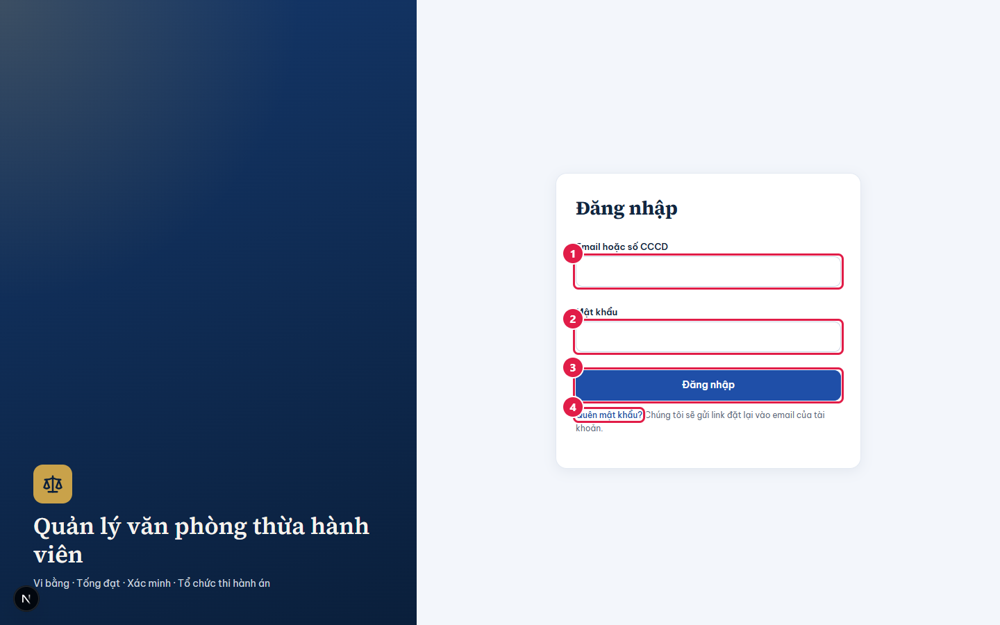

1. Nhập email hoặc số CCCD do Văn phòng cấp
2. Nhập Mật khẩu
3. Bấm Đăng nhập để vào hệ thống
4. Quên mật khẩu: nhận link đặt lại qua email

#### Bước 1.2 · Khi nhập sai email hoặc mật khẩu

Hệ thống báo lỗi ngay dưới ô nhập và không cho vào. Nhập lại cho đúng; sai quá 5 lần sẽ bị khóa 15 phút.

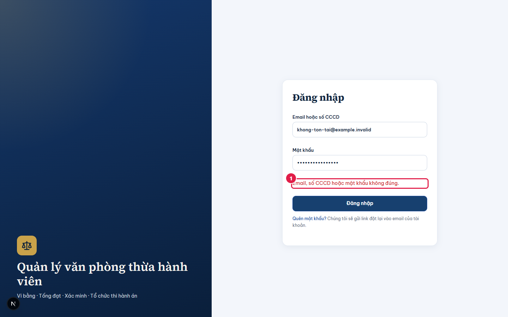

1. Thông báo lỗi: kiểm tra lại email hoặc số CCCD và mật khẩu

**Lỗi thường gặp và cách xử lý**

| Hiện tượng | Cách xử lý |
| --- | --- |
| Báo "Email, số CCCD hoặc mật khẩu không đúng" | Kiểm tra gõ đúng email hoặc số CCCD Văn phòng cấp, tắt Caps Lock. Mật khẩu phân biệt chữ hoa và chữ thường. |
| Quên mật khẩu | Bấm "Quên mật khẩu" ở màn đăng nhập, nhập email; hệ thống gửi link đặt lại vào email của tài khoản. Cũng có thể nhờ Admin đặt lại. |
| Báo tài khoản bị khóa tạm thời | Đã nhập sai quá 5 lần. Đợi 15 phút rồi thử lại, hoặc nhờ Admin. |
| Vào được nhưng thiếu mục trên thanh bên | Mỗi vai chỉ thấy mục thuộc vai của mình. Cần thêm quyền thì nhờ Admin. |

### 2. Làm quen với màn hình làm việc

Mọi màn đều có cùng bố cục: thanh bên trái để chuyển mục, thanh trên cùng để tìm kiếm, nhận thông báo và quản lý tài khoản, vùng giữa là nội dung.

**Cần nhớ:**

- Thanh bên chia nhóm Công việc, Nghiệp vụ, Văn phòng (Admin có thêm Quản trị). Mỗi người chỉ thấy mục thuộc vai của mình.
- Hồ sơ đã lưu chính thức không sửa trực tiếp, không xóa. Mọi thay đổi quan trọng đều lưu người làm, thời điểm và lý do.

#### Bước 2.1 · Thanh bên, ô tìm kiếm, chuông thông báo và tài khoản

Đây là trang Hồ sơ do tôi tạo, điểm bắt đầu của hầu hết các vai.

- Thanh bên: bấm tên mục để chuyển màn. Mục đang mở được tô sáng.
- Ô Tìm kiếm (hoặc bấm Ctrl K ở bất kỳ màn nào): tìm nhanh hồ sơ và trang.
- Chuông: mở danh sách thông báo (nhắc hạn, việc được giao).
- Thẻ tài khoản: xem tên, vai, đăng xuất.

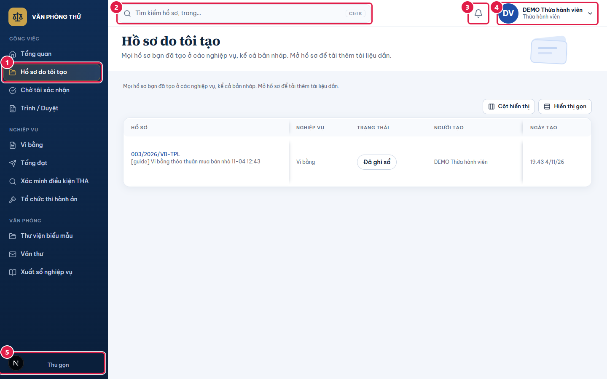

1. Thanh bên: bấm tên mục để chuyển màn
2. Ô tìm nhanh (phím tắt Ctrl K)
3. Chuông thông báo
4. Thẻ tài khoản: tên, vai, đăng xuất
5. Thu gọn thanh bên cho màn rộng hơn

#### Bước 2.2 · Thanh bên đã thu gọn

Thanh bên thu thành một cột biểu tượng để vùng làm việc rộng hơn. Di chuột vào biểu tượng để xem tên mục; bấm nút mũi tên để mở lại. Máy nhớ lựa chọn của bạn.

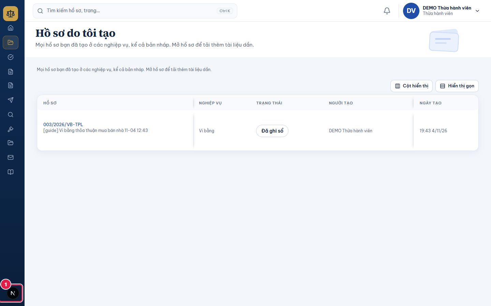

1. Bấm lại để mở rộng thanh bên

### 3. Đọc và lọc danh sách hồ sơ

Bốn nghiệp vụ (Vi bằng, Tống đạt, Xác minh điều kiện THA, Tổ chức thi hành án) dùng chung một kiểu danh sách. Học một lần dùng cho cả bốn.

**Cần nhớ:**

- Danh sách chỉ hiện hồ sơ trong phạm vi quyền của bạn.
- Hồ sơ Nháp và Đã hủy nằm ở tab riêng, không lẫn vào Chính thức.

#### Bước 3.1 · Danh sách hồ sơ: tab, bộ lọc và ô tìm

Mỗi dòng là một hồ sơ. Dòng trên cùng là các tab trạng thái; bên dưới là thanh bộ lọc.

- Tab Chính thức: hồ sơ đã ghi sổ. Thiếu scan / Đủ scan: lọc theo tình trạng bản scan. Nháp và Đã hủy: có số hồ sơ đếm trong ngoặc.
- Ô tìm: gõ số văn bản, tên người, trích yếu hoặc nội dung rồi bấm Tìm.
- Năm: chọn năm ghi sổ cần xem. Loại tài liệu, Người tạo, Đơn vị, Tình trạng scan: thu hẹp danh sách.

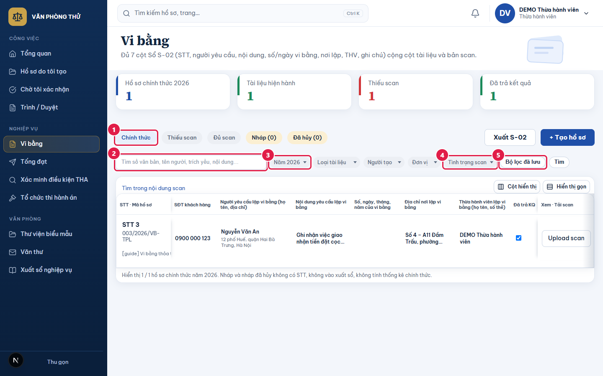

1. Tab trạng thái: Chính thức, Thiếu scan, Đủ scan, Nháp, Đã hủy
2. Gõ từ khóa rồi bấm Tìm
3. Chọn Năm
4. Lọc theo Tình trạng scan
5. Lưu và mở lại cách lọc hay dùng

#### Bước 3.2 · Bảng hồ sơ: số hồ sơ, SĐT, ô Đã trả kết quả

Mỗi hồ sơ chính thức có số hồ sơ do hệ thống cấp. Ô tích Đã trả kết quả chỉ để theo dõi, không đổi trạng thái hồ sơ.

- Bấm số hồ sơ để mở hồ sơ.
- Ô tích Đã trả kết quả: tích khi đã trả kết quả cho khách; số lượng này hiện ở thẻ "Đã trả kết quả" trên Tổng quan.
- Cột SĐT khách hàng chỉ để liên hệ, không in ra sổ.

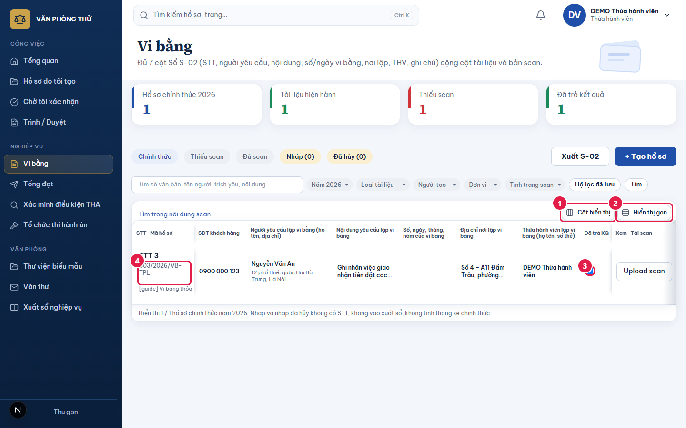

1. Bật/tắt cột hiển thị
2. Thu gọn hàng để xem được nhiều dòng hơn
3. Tích khi đã trả kết quả cho khách
4. Bấm số hồ sơ để mở hồ sơ

#### Bước 3.3 · Bộ lọc đã lưu

Đặt tên cho cách lọc đang dùng rồi bấm Lưu; lần sau chỉ cần bấm tên bộ lọc. Tối đa 30 bộ lọc.

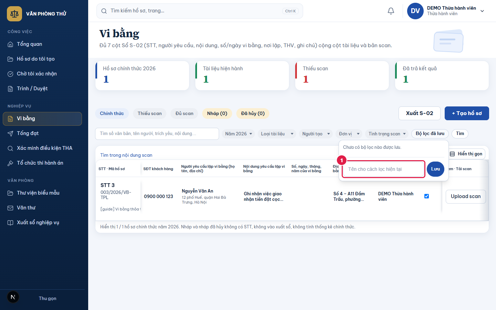

1. Đặt tên rồi bấm Lưu

**Lỗi thường gặp và cách xử lý**

| Hiện tượng | Cách xử lý |
| --- | --- |
| Không thấy hồ sơ cần tìm | Kiểm tra đang đứng ở tab nào (Chính thức, Nháp, Đã hủy), bỏ bớt bộ lọc, chọn đúng Năm. Hồ sơ ngoài phạm vi quyền sẽ không hiện. |
| Cột bị thiếu hoặc quá chật | Bấm Cột hiển thị để bật/tắt cột, hoặc bấm Hiển thị gọn để thu hàng. |

### 4. Tìm trong nội dung bản scan

Hệ thống nhận dạng chữ (OCR) trong các tệp scan sau khi tải lên, thường trong 1 đến 2 phút, để bạn tìm hồ sơ theo nội dung bên trong.

**Cần nhớ:**

- Kết quả chỉ trỏ về hồ sơ gốc, không sửa gì. Chỉ hiện hồ sơ trong phạm vi quyền của bạn.

#### Bước 4.1 · Tìm trong nội dung scan

Gõ từ khóa, chọn bộ lọc nếu cần rồi bấm Tìm. Mỗi dòng kết quả là một tệp scan khớp, kèm đoạn trích.

- Kết quả xếp theo độ khớp.
- Số trong ngoặc ở các bộ lọc là số hồ sơ chính thức của từng lựa chọn.
- Bấm Mở hồ sơ để vào đúng hồ sơ chứa tệp đó.

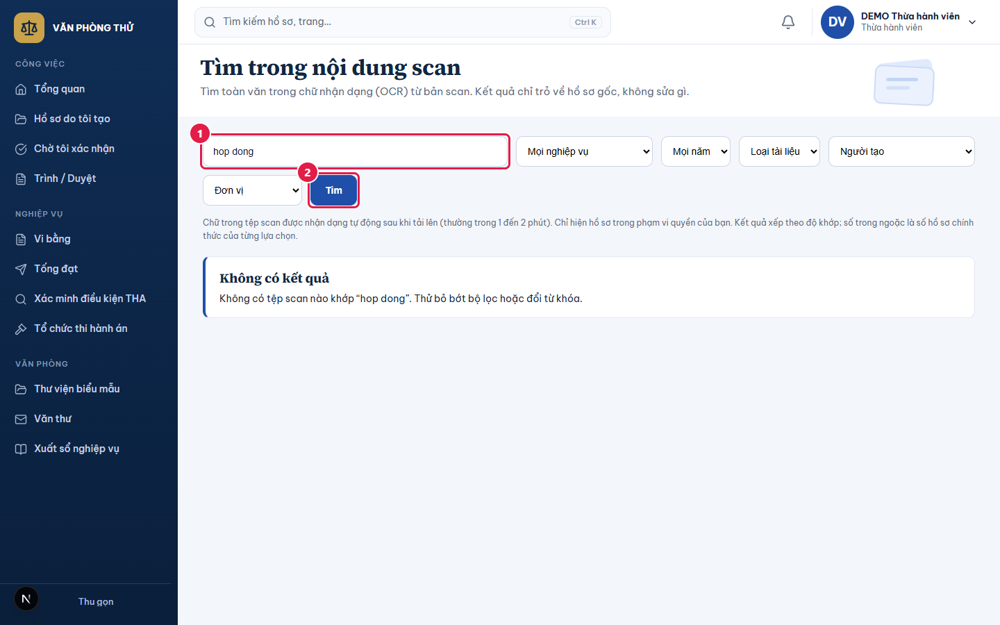

1. Từ khóa trong chữ nhận dạng từ bản scan
2. Bấm Tìm

### 5. Thông báo

Chuông ở góc trên bên phải gom các thông báo của riêng bạn: nhắc hạn, việc được giao, kết quả duyệt.

#### Bước 5.1 · Trang Thông báo

Chuyển giữa các nhóm bằng các nút chữ phía trên danh sách. Bấm vào thông báo để mở đúng hồ sơ liên quan.

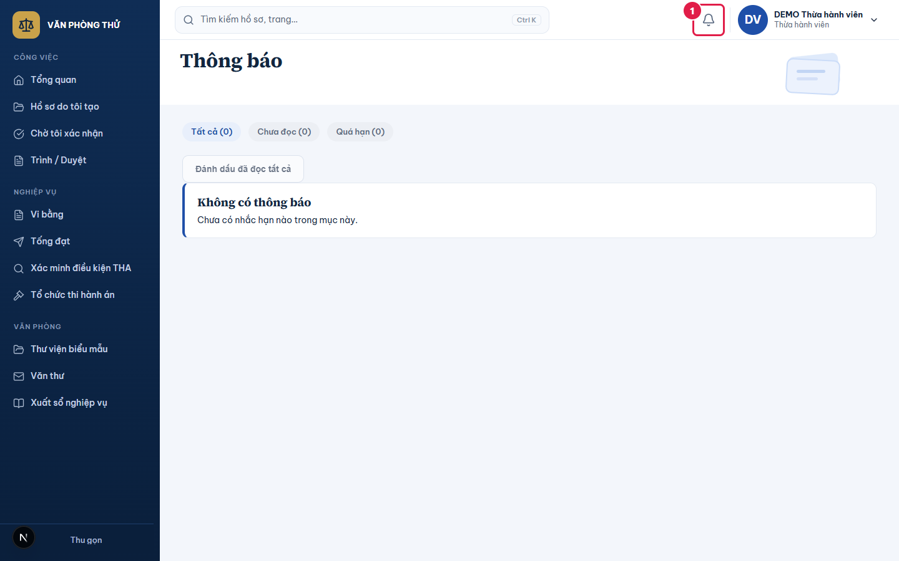

1. Chuông thông báo trên thanh trên

### 6. Xuất sổ nghiệp vụ

Các sổ S-01 (tống đạt), S-02 (lập vi bằng), S-04 (xác minh điều kiện thi hành án), S-05 (thi hành án) được dựng tự động từ hồ sơ đã lưu chính thức. Bạn xem trước rồi xuất PDF để in hoặc Excel.

**Cần nhớ:**

- Sổ chỉ gồm hồ sơ đã lưu chính thức của năm đang chọn. Bản nháp và hồ sơ đã hủy không vào sổ.
- Cột SĐT khách hàng không in ra sổ.
- Sổ điện tử hỗ trợ tra cứu và in; sổ giấy chính thức vẫn do văn phòng ký và đóng dấu giáp lai.

#### Bước 6.1 · Chọn sổ cần xuất

Mỗi thẻ là một sổ. Bấm "Xem trước và xuất ..." để mở sổ.

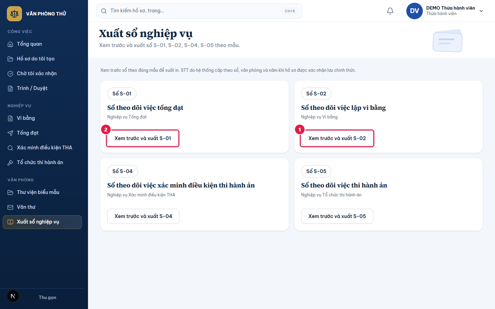

1. Mở sổ S-02 (theo dõi việc lập vi bằng)
2. Các sổ khác: S-01, S-04, S-05

#### Bước 6.2 · Xem trước và xuất sổ S-02

Chọn Năm, bấm Xem để dựng bản xem trước. Dùng "Xuất PDF để in" hoặc "Xuất Excel" khi cần lưu hoặc in.

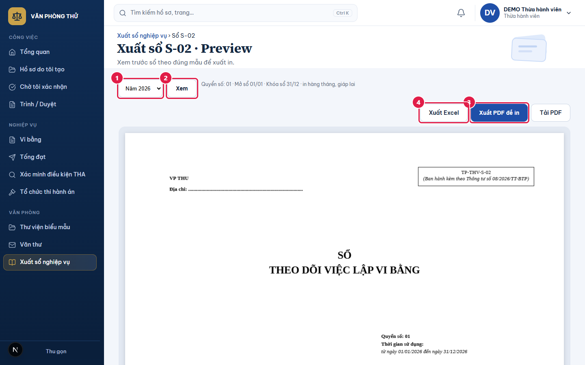

1. Chọn Năm của sổ
2. Dựng bản xem trước
3. Xuất PDF để in
4. Xuất Excel

**Lỗi thường gặp và cách xử lý**

| Hiện tượng | Cách xử lý |
| --- | --- |
| Sổ trống | Năm đang chọn chưa có hồ sơ chính thức. Đổi Năm hoặc lưu chính thức hồ sơ trước. |
| Bản xem trước hiện "Đang dựng bản xem trước" | Chờ vài giây để hệ thống dựng PDF; nếu lâu, bấm Xem lại. |

### 7. Thư viện biểu mẫu

Nơi tra cứu và tải các biểu mẫu (phụ lục) của văn phòng.

**Cần nhớ:**

- Thư viện chỉ để tải và soạn; việc ký và ban hành vẫn do người có thẩm quyền làm ngoài đời.

#### Bước 7.1 · Thư viện biểu mẫu

Gõ tên vào ô tìm rồi bấm Tìm. Bấm "Tải về" để lấy biểu mẫu.

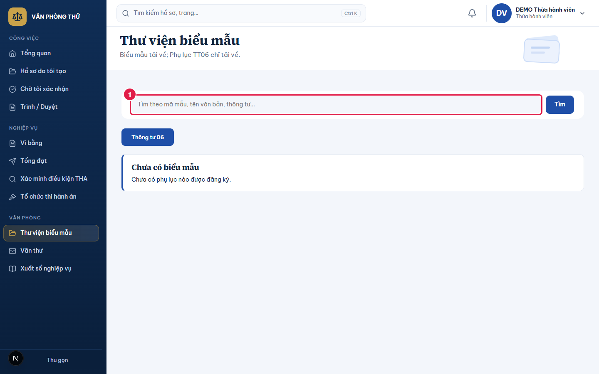

1. Tìm biểu mẫu theo tên

### 8. Dùng trên điện thoại

Trên màn nhỏ (dưới 600 px), mỗi hồ sơ hiện thành một thẻ có đủ nhãn thay cho bảng nhiều cột.

#### Bước 8.1 · Danh sách hồ sơ trên điện thoại

Mỗi thẻ là một hồ sơ, các thông tin ghi rõ tên trường. Bấm số hồ sơ để mở hồ sơ. Cuộn xuống để xem thẻ tiếp theo.

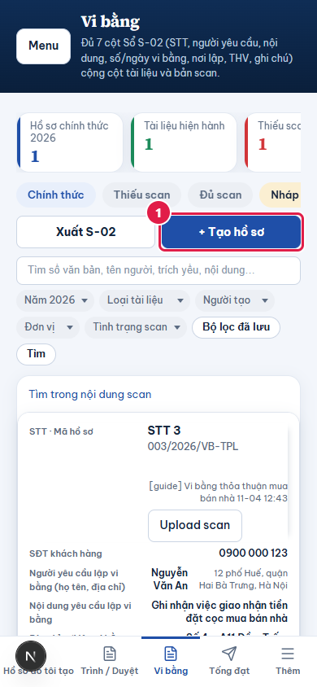

1. Bấm số hồ sơ để mở hồ sơ

## Dành cho Admin

### 9. Tổng quan của Admin

Tổng quan cho biết nhanh tình hình năm hiện tại: số hồ sơ, tài liệu, hồ sơ thiếu scan, số hồ sơ đã trả kết quả và các bản trình đang chờ bạn duyệt.

**Cần nhớ:**

- Số liệu chỉ tính hồ sơ đã lưu chính thức, không tính bản nháp và hồ sơ đã hủy.

#### Bước 9.1 · Trang Tổng quan

Bốn thẻ số liệu ở trên, bên dưới là biểu đồ hồ sơ theo nghiệp vụ và danh sách hồ sơ cần bổ sung scan.

- Hồ sơ năm: số hồ sơ chính thức của năm hiện tại.
- Tài liệu hiện hành: số tài liệu đang có hiệu lực (không tính các bản đã được thay bằng phiên bản mới).
- Hồ sơ thiếu scan: có tài liệu nhưng chưa có bản scan, cần bổ sung.
- Đã trả kết quả: số hồ sơ đã được tích Đã trả kết quả.
- Cần bổ sung scan: bấm Mở để vào thẳng hồ sơ thiếu scan.

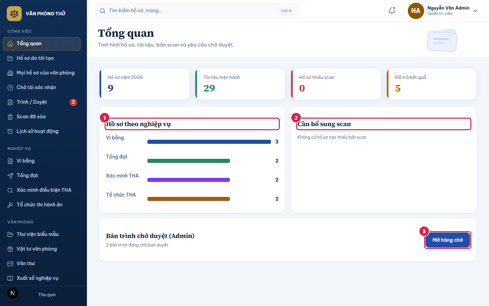

1. Số hồ sơ theo từng nghiệp vụ: bấm tên để mở danh sách
2. Hồ sơ còn thiếu bản scan
3. Mở hàng chờ duyệt bản trình (chỉ hiện khi có bản đang chờ)

**Lỗi thường gặp và cách xử lý**

| Hiện tượng | Cách xử lý |
| --- | --- |
| Không thấy khối "Bản trình chờ duyệt" | Khối này chỉ hiện khi đang có bản trình chờ duyệt. Hết bản trình chờ thì khối tự ẩn. |

### 10. Trình / Duyệt bản trình

Bản trình là cách nhân viên (Thừa hành viên, Văn thư) gửi tiêu đề, mô tả và bản scan lên để Admin duyệt hoặc từ chối. Bản trình KHÔNG phải hồ sơ nghiệp vụ và không tạo số hồ sơ.

**Cần nhớ:**

- "Duyệt" trong phần mềm là xác nhận nội bộ, không phải chữ ký pháp lý.
- Từ chối bắt buộc nhập ghi chú. Duyệt thì ghi chú không bắt buộc.
- Bản trình không bao giờ bị xóa; chỉ file scan xóa được, với người có quyền xóa scan.
- Người gửi chỉ thấy bản trình của mình. Admin thấy bản trình của cả văn phòng.

#### Bước 10.1 · Hàng chờ duyệt của Admin

Admin thấy bản trình của mọi người. Huy hiệu đỏ trên thanh bên cho biết số bản đang chờ.

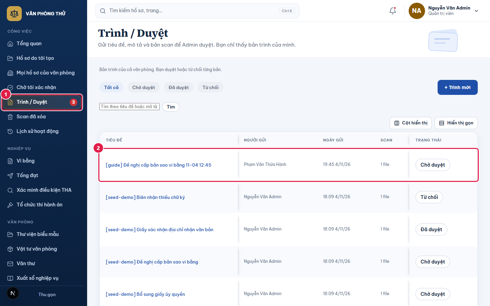

1. Thanh bên: số bản trình đang chờ duyệt
2. Bản trình cần xem

#### Bước 10.2 · Xem bản trình và quyết định

Xem thông tin người gửi và bản scan ngay trong trang. Nhập ghi chú rồi bấm Duyệt hoặc Từ chối.

- Ghi chú: bắt buộc khi từ chối, tùy chọn khi duyệt.
- Thêm scan: bổ sung bản scan cho bản trình nếu còn thiếu.
- Xóa scan: chỉ người có quyền xóa scan mới thấy nút này.

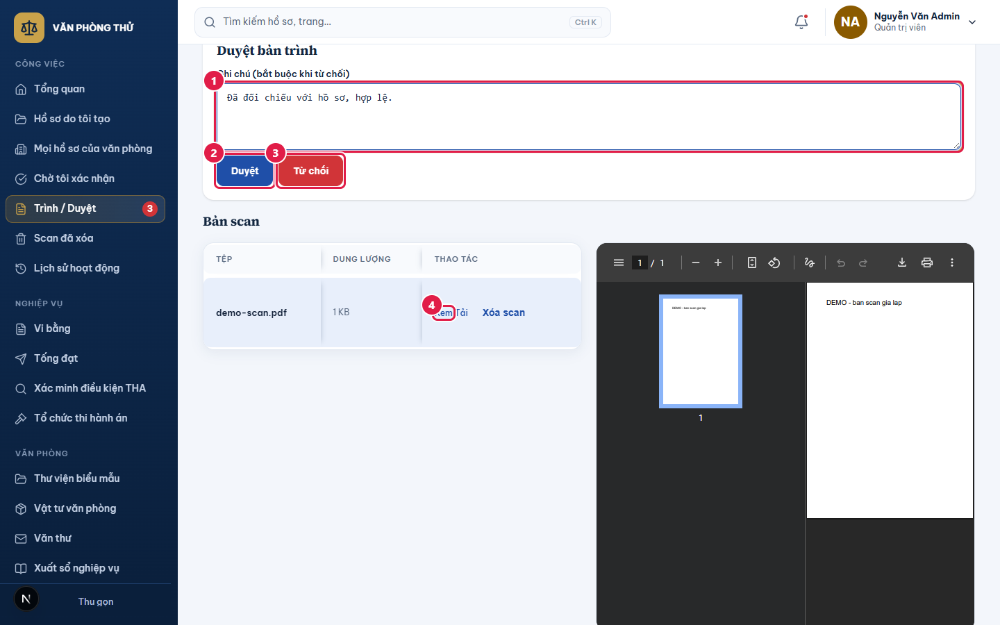

1. Ghi chú (bắt buộc khi từ chối)
2. Duyệt bản trình
3. Từ chối bản trình (phải có ghi chú)
4. Xem bản scan của bản trình

#### Bước 10.3 · Bản trình đã duyệt

Trạng thái chuyển sang Đã duyệt, kèm người duyệt, thời điểm và ghi chú. Bản trình đã quyết định không duyệt lại được.

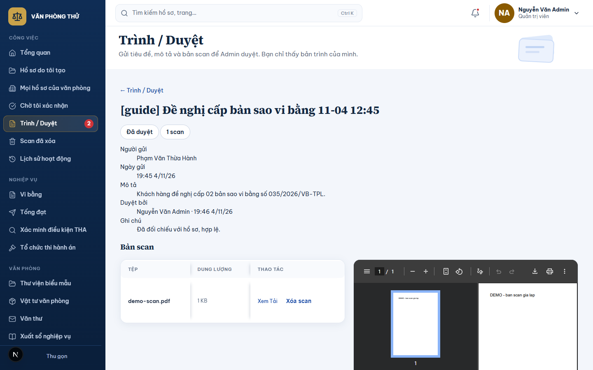

**Lỗi thường gặp và cách xử lý**

| Hiện tượng | Cách xử lý |
| --- | --- |
| Bấm Từ chối nhưng không có gì xảy ra | Chưa nhập Ghi chú. Từ chối bắt buộc có ghi chú để người gửi biết lý do. |
| Muốn duyệt lại bản đã duyệt hoặc đã từ chối | Không được. Mỗi bản trình chỉ duyệt hoặc từ chối một lần; nếu cần, người gửi gửi bản trình mới. |

### 11. Admin sửa hồ sơ đã ghi sổ

Hồ sơ đã lưu chính thức không sửa trực tiếp. Chỉ Admin sửa được nội dung, bắt buộc nêu lý do; mỗi lần sửa tạo một phiên bản mới, bản gốc khi ghi sổ vẫn được giữ.

**Cần nhớ:**

- Số hồ sơ (STT) giữ nguyên khi sửa. Hồ sơ không bao giờ bị xóa.
- Mọi lần sửa đều ghi người sửa, thời điểm, lý do trong Lịch sử hoạt động.
- Nhân viên khác chỉ tải thêm scan, không sửa được.

#### Bước 11.1 · Nút "Sửa hồ sơ (Admin)"

Chỉ Admin thấy nút này trên hồ sơ đã ghi sổ. Bấm để mở hộp thoại sửa.

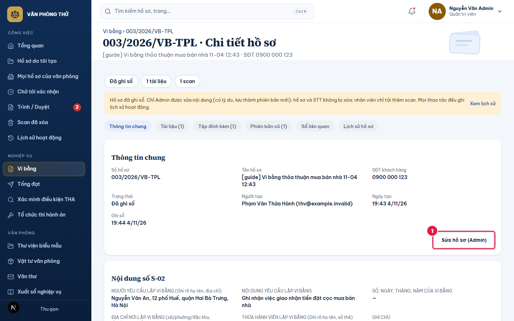

1. Sửa hồ sơ (chỉ Admin)

#### Bước 11.2 · Hộp thoại Sửa hồ sơ (Admin)

Sửa các ô cần thiết, bắt buộc nhập Lý do sửa, rồi bấm Lưu thay đổi. Hệ thống lưu thành phiên bản mới.

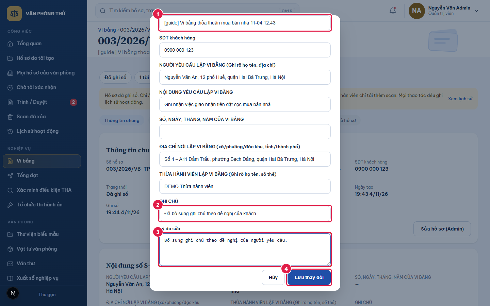

1. Tên hồ sơ
2. Ô cần sửa (ví dụ Ghi chú)
3. Lý do sửa (bắt buộc)
4. Lưu thành phiên bản mới

#### Bước 11.3 · Tab Phiên bản cũ: bản gốc và bản sửa

Mỗi lần Admin sửa tạo thêm một dòng: bản gốc khi ghi sổ và các bản sửa kèm người sửa, thời điểm và lý do.

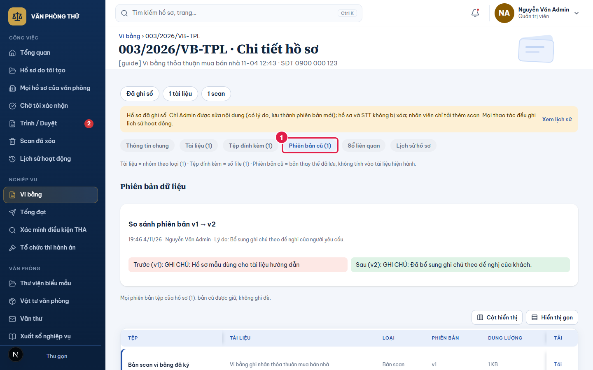

1. Tab Phiên bản cũ

**Lỗi thường gặp và cách xử lý**

| Hiện tượng | Cách xử lý |
| --- | --- |
| Bấm Lưu thay đổi nhưng báo thiếu lý do | Ô Lý do sửa là bắt buộc. Nêu rõ chỗ sửa và vì sao. |
| Cần xem nội dung trước khi sửa | Mở tab Phiên bản cũ để xem bản gốc và các bản sửa trước đó. |

### 12. Xóa scan và mục Scan đã xóa

Chỉ file scan xóa được; hồ sơ, số hồ sơ và dòng sổ vẫn còn nguyên. File bị xóa chuyển vào mục "Scan đã xóa 30 ngày", chỉ Admin xem và tải được.

**Cần nhớ:**

- Cần quyền riêng "xóa scan" do Admin cấp. Quyền này không nằm trong nhóm quyền mặc định.
- Bắt buộc nêu lý do xóa. Sau 30 ngày file bị xóa hẳn khỏi kho và không khôi phục được.
- Nếu cần giữ lại, Admin tải file về từ mục Scan đã xóa trong vòng 30 ngày.

#### Bước 12.1 · Hộp thoại Xóa file scan

Đọc kỹ ba lưu ý trong hộp thoại, nhập lý do rồi bấm Xóa scan. Hồ sơ và dòng sổ không bị ảnh hưởng.

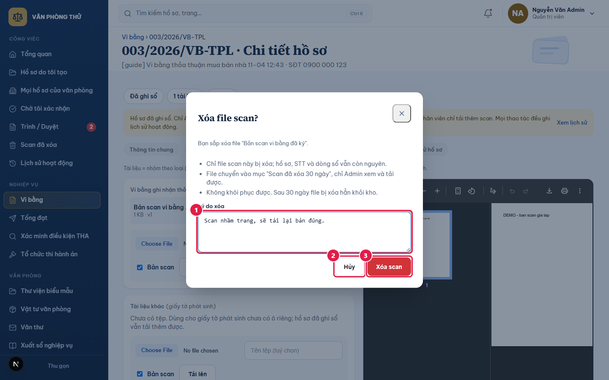

1. Lý do xóa (bắt buộc)
2. Hủy: không xóa
3. Xóa scan: file chuyển vào Scan đã xóa 30 ngày

#### Bước 12.2 · Mục Scan đã xóa 30 ngày

Liệt kê file đã xóa kèm hồ sơ gốc, người xóa, ngày xóa, lý do và số ngày còn lại. Bấm Tải để lấy lại file trong thời hạn.

- Cột Còn lại: số ngày đến khi file bị xóa hẳn khỏi kho.
- Cột Tải: tải file về máy (chỉ Admin).

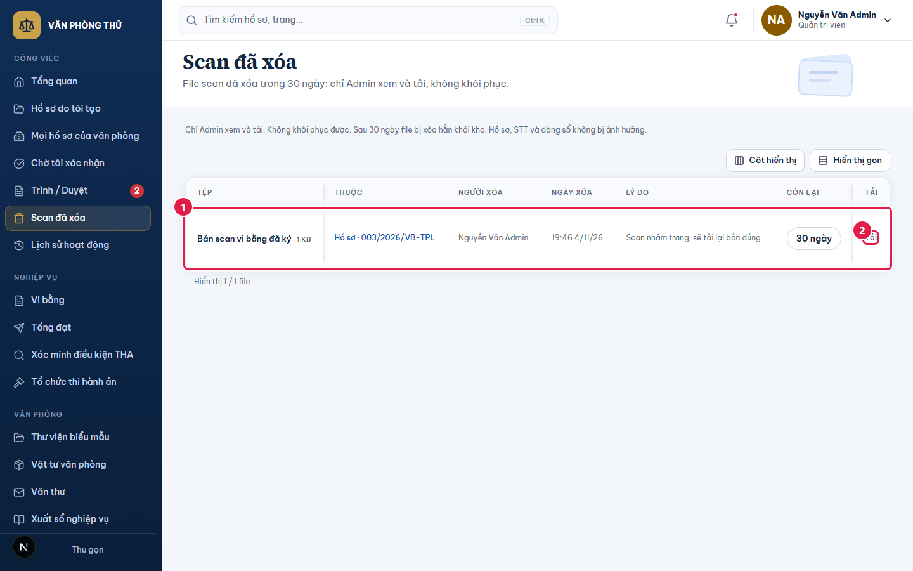

1. File vừa xóa: xem lý do, người xóa, còn bao nhiêu ngày
2. Tải file về máy

**Lỗi thường gặp và cách xử lý**

| Hiện tượng | Cách xử lý |
| --- | --- |
| Không thấy nút Xóa scan | Bạn chưa được cấp quyền xóa scan. Nhờ Admin cấp quyền riêng cho đúng người, đúng thời gian cần. |
| Xóa nhầm file | Vào Scan đã xóa, tải file về (còn trong 30 ngày) rồi tải lên lại ở tab Tài liệu. |

### 13. Lịch sử hoạt động

Nhật ký mọi thay đổi quan trọng trên hồ sơ, tài liệu, tệp scan, bản trình và phân quyền: ai làm, lúc nào, làm gì. Chỉ Admin xem được.

**Cần nhớ:**

- Nhật ký chỉ ghi thêm, không sửa, không xóa.

#### Bước 13.1 · Lịch sử hoạt động

Chọn nhóm bằng các nút phía trên, hoặc gõ số hồ sơ, tên người, từ khóa vào ô tìm. Bấm vào tên đối tượng để mở thẳng hồ sơ.

- Thời gian, Người làm, Hoạt động, Đối tượng, Chi tiết: mỗi dòng là một thao tác.
- Nhóm: Hồ sơ, Tài liệu, Tệp & scan, Trình / Duyệt, Phân quyền.

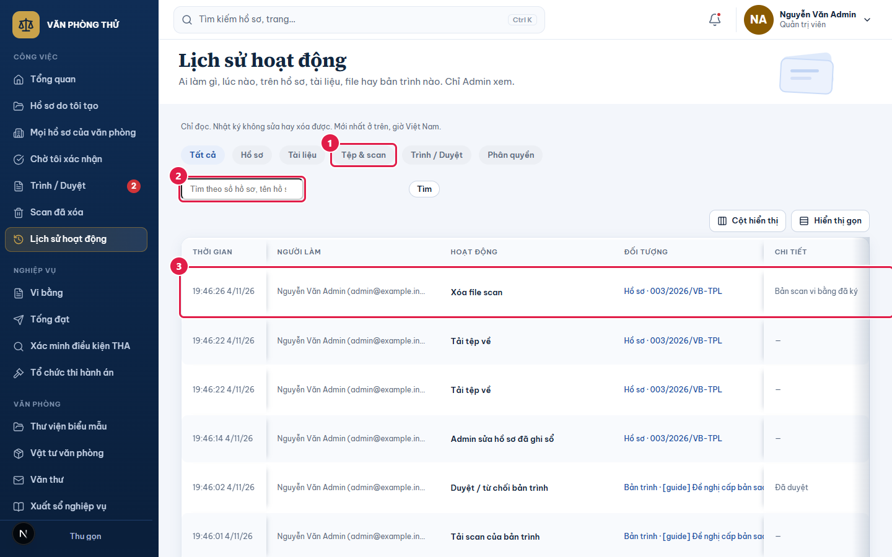

1. Lọc theo nhóm hoạt động
2. Tìm theo số hồ sơ, người làm hoặc từ khóa
3. Một thao tác: người làm, hoạt động, đối tượng, chi tiết

### 14. Admin: soạn nháp và chọn Thừa hành viên ghi tên

Khi Admin soạn bản nháp, chọn thừa hành viên được ghi tên rồi Lưu. Hồ sơ sẽ hiện ở mục "Chờ tôi xác nhận" của thừa hành viên đó để họ xem lại và xác nhận lưu chính thức.

**Cần nhớ:**

- Chỉ người có quyền xem danh sách thừa hành viên mới chọn được. Chọn "Không ghi tên" nếu chưa biết.
- Admin chỉ thấy bản nháp do chính mình soạn, không thấy bản nháp của người khác.

#### Bước 14.1 · Chọn thừa hành viên được ghi tên

Ở đầu bản nháp, chọn thừa hành viên rồi bấm Lưu. Hồ sơ sẽ hiện ở "Chờ tôi xác nhận" của thừa hành viên đó.

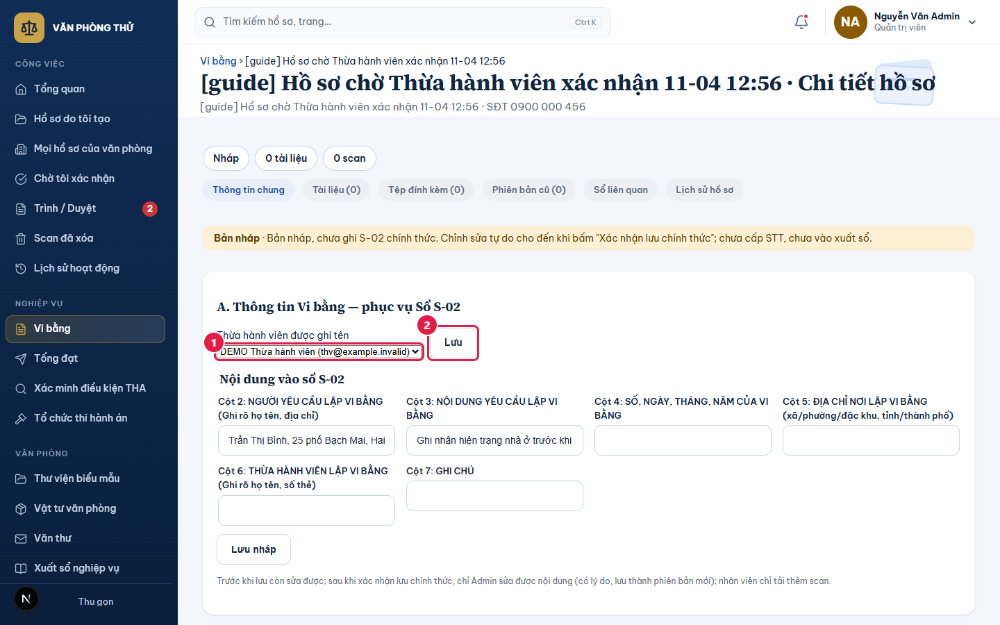

1. Thừa hành viên được ghi tên
2. Lưu để giao cho thừa hành viên

**Lỗi thường gặp và cách xử lý**

| Hiện tượng | Cách xử lý |
| --- | --- |
| Thừa hành viên không thấy hồ sơ trong "Chờ tôi xác nhận" | Chưa chọn đúng thừa hành viên ở ô "Thừa hành viên được ghi tên" hoặc chưa bấm Lưu. |

### 15. Quản trị · Tài khoản

Admin tạo tài khoản cho thành viên văn phòng: họ tên, email, số CCCD (không bắt buộc) và mật khẩu ban đầu. Quyền không nằm ở đây mà ở mục Nhóm quyền. Mọi màn quản trị nằm trong nhóm QUẢN TRỊ của thanh bên (Tài khoản, Nhóm quyền, Chi nhánh, Cài đặt văn phòng).

**Cần nhớ:**

- Mỗi người một tài khoản riêng. Đăng nhập bằng email hoặc số CCCD cùng mật khẩu; quên mật khẩu thì dùng liên kết "Quên mật khẩu" ở màn đăng nhập (link đặt lại gửi qua email).
- Mật khẩu ban đầu tối thiểu 12 ký tự; người dùng phải đổi mật khẩu ngay ở lần đăng nhập đầu.
- Tài khoản vừa tạo chưa có quyền gì cho tới khi được xếp vào nhóm quyền.

#### Bước 15.1 · Tài khoản: danh sách thành viên

Các thẻ Tất cả, Chưa có quyền, Tạm khóa lọc nhanh theo trạng thái; số đếm hiện bên cạnh.

- Dãy mục bên trái (Tài khoản, Nhóm quyền, Chi nhánh, Cài đặt văn phòng) là các màn quản trị.
- + Thêm thành viên: tạo tài khoản mới.
- Xem quyền hiệu lực: mở chi tiết quyền thực sự của người đó.
- Sửa tên: đổi họ tên hiển thị.

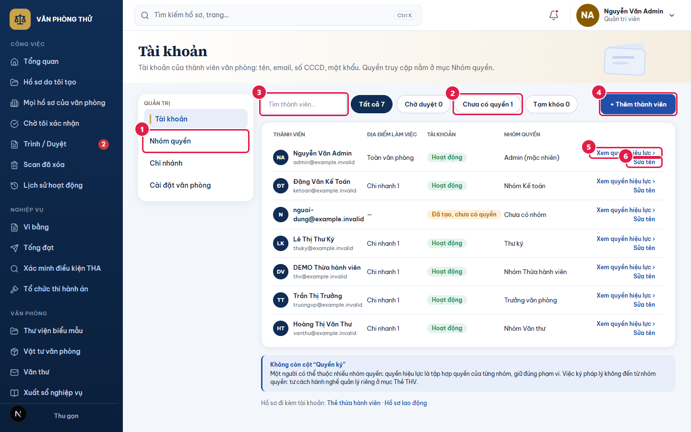

1. Các mục quản trị khác (Nhóm quyền, Chi nhánh, Cài đặt văn phòng)
2. Lọc: thành viên chưa được xếp vào nhóm quyền
3. Tìm theo tên hoặc email
4. Thêm thành viên mới
5. Xem quyền hiệu lực của người này
6. Đổi họ tên hiển thị

#### Bước 15.2 · Thêm thành viên mới

Điền họ tên, email, CCCD (nếu có), mật khẩu ban đầu và nhập lại; chọn nhóm quyền và quyền chi tiết (tùy chọn) rồi bấm tạo. Tài khoản có hiệu lực ngay, không cần ai duyệt.

- Số CCCD: 12 chữ số, không trùng tài khoản khác. Có CCCD thì đăng nhập được bằng CCCD.
- Mật khẩu ban đầu: tối thiểu 12 ký tự; người dùng đổi ở lần đăng nhập đầu.
- Nhóm quyền: tích nhóm cần xếp người này vào. Quyền chi tiết (tùy chọn) thêm hoặc bỏ riêng từng quyền.

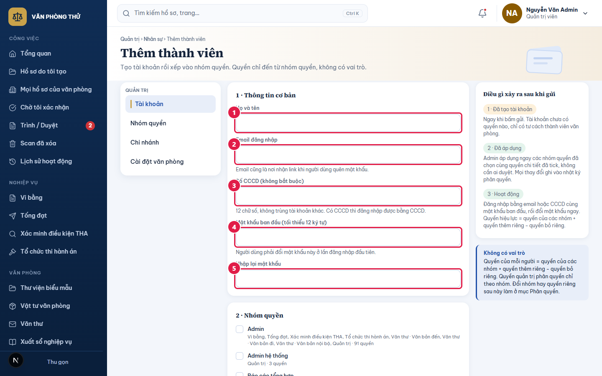

1. Họ và tên
2. Email đăng nhập (cũng là nơi nhận link đặt lại mật khẩu)
3. Số CCCD 12 chữ số (không bắt buộc)
4. Mật khẩu ban đầu, tối thiểu 12 ký tự
5. Nhập lại mật khẩu

**Lỗi thường gặp và cách xử lý**

| Hiện tượng | Cách xử lý |
| --- | --- |
| Người mới đăng nhập được nhưng không thấy gì | Chưa được xếp vào nhóm quyền: mở Nhóm quyền rồi bấm Gán nhóm quyền (thẻ Chưa có quyền lọc ra những người này). |
| Cần đổi họ tên hiển thị | Bấm Sửa tên ở dòng thành viên. |
| Người dùng quên mật khẩu | Họ tự bấm Quên mật khẩu ở màn đăng nhập; Admin cũng có thể đặt lại mật khẩu cho họ, khi đó họ phải đổi mật khẩu ở lần đăng nhập kế tiếp. |

### 16. Quản trị · Chi nhánh

Chi nhánh (địa điểm hoạt động) quyết định hồ sơ của ai hiện ở đâu. Thành viên chỉ thấy hồ sơ thuộc chi nhánh được cấp.

**Cần nhớ:**

- Hồ sơ chưa gắn chi nhánh chỉ Admin thấy; gắn chi nhánh để đúng người thấy.

#### Bước 16.1 · Chi nhánh và hồ sơ chưa gắn chi nhánh

Phần trên là danh sách địa điểm; phần dưới liệt kê hồ sơ chưa gắn chi nhánh để bạn chọn nhiều hồ sơ rồi gắn một lần.

- + Thêm địa điểm: tạo chi nhánh mới.
- Đổi tên: sửa tên chi nhánh.
- Xem người được cấp: những ai được xem hồ sơ của chi nhánh này.
- Gắn chi nhánh: tích các hồ sơ, chọn chi nhánh đích rồi bấm nút.

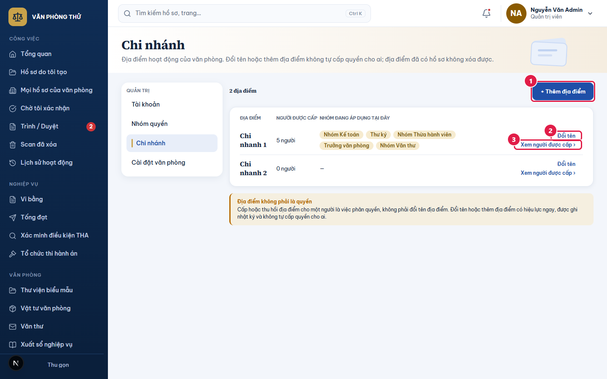

1. Thêm địa điểm (chi nhánh) mới
2. Đổi tên chi nhánh
3. Xem ai được cấp chi nhánh này

### 17. Quản trị · Nhóm quyền và phân quyền

Quyền của mỗi người = các nhóm quyền người đó thuộc + quyền thêm hoặc bỏ riêng. Chỉ Admin tạo nhóm, đổi quyền của nhóm, xếp người vào nhóm và đặt quyền riêng. Mọi thay đổi có hiệu lực ngay (không còn đề xuất và duyệt) và được ghi vào Lịch sử hoạt động, nhóm Phân quyền.

**Cần nhớ:**

- Nhóm "Admin" là nhóm hệ thống: không xóa, không ngừng dùng, không đổi quyền; người thuộc nhóm Admin và tài khoản Admin không đặt được quyền riêng.
- Mỗi thay đổi cần ghi lý do ngắn (bắt buộc, trừ khi Admin tự đổi quyền riêng của chính mình thì không cần).
- Quyền "xóa scan" chỉ cấp riêng cho từng người, không nằm trong nhóm quyền.

#### Bước 17.1 · Nhóm quyền: danh sách nhóm

Mỗi nhóm cho biết số quyền, số thành viên và trạng thái. Bấm tên nhóm để xem và sửa; bấm "+ Tạo nhóm quyền" để tạo nhóm mới hoặc sao chép từ nhóm mẫu.

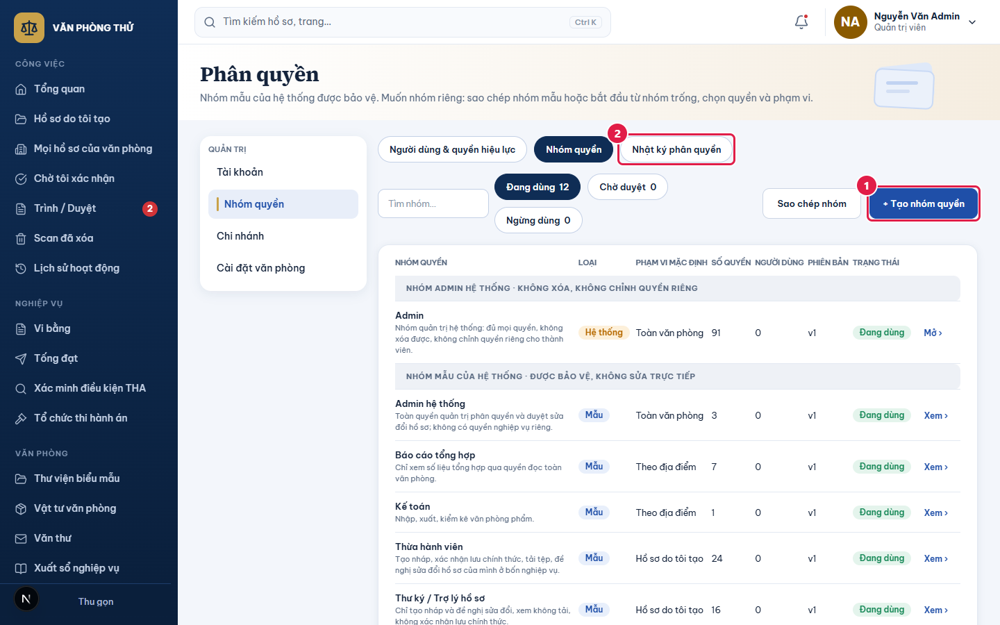

1. Tạo nhóm quyền mới hoặc sao chép nhóm mẫu
2. Nhật ký phân quyền (mở Lịch sử hoạt động)

#### Bước 17.2 · Người dùng và quyền hiệu lực

Mỗi dòng là một thành viên với nhóm quyền, phạm vi và tình trạng tài khoản. Bấm Xem để mở chi tiết; "Gán nhóm quyền" xếp người vào nhóm.

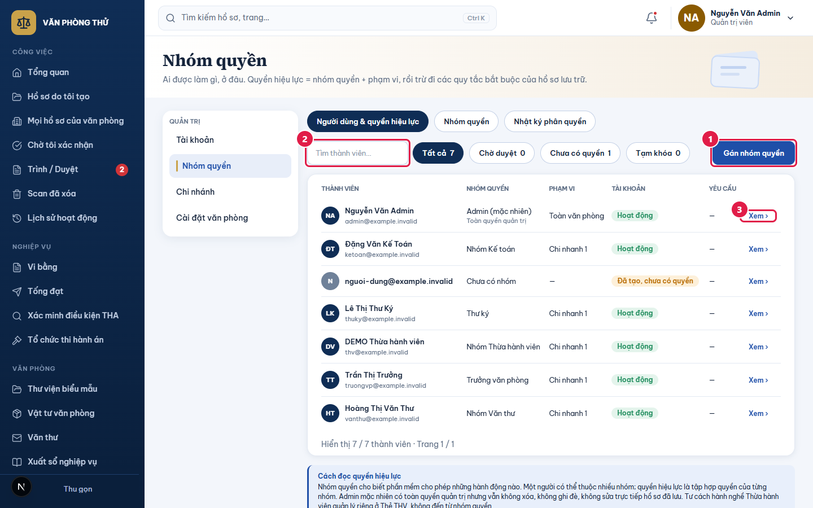

1. Xếp thành viên vào một nhóm quyền
2. Tìm thành viên
3. Mở chi tiết quyền của người này

#### Bước 17.3 · Chi tiết một tài khoản: Quyền

Ba thẻ: Quyền, Thẻ thừa hành viên, Hồ sơ lao động. Thẻ Quyền cho thấy nhóm đang áp dụng, quyền hiệu lực theo nghiệp vụ và chi nhánh được xem.

- Nhóm quyền đang áp dụng: các nhóm người này thuộc.
- Đổi nhóm quyền: xếp vào hoặc gỡ khỏi nhóm, có hiệu lực ngay.
- Tạm khóa tài khoản: chặn đăng nhập mà không xóa dữ liệu.
- Cấp chi nhánh: người này chỉ thấy hồ sơ của chi nhánh được cấp (hồ sơ do chính họ tạo luôn thấy).

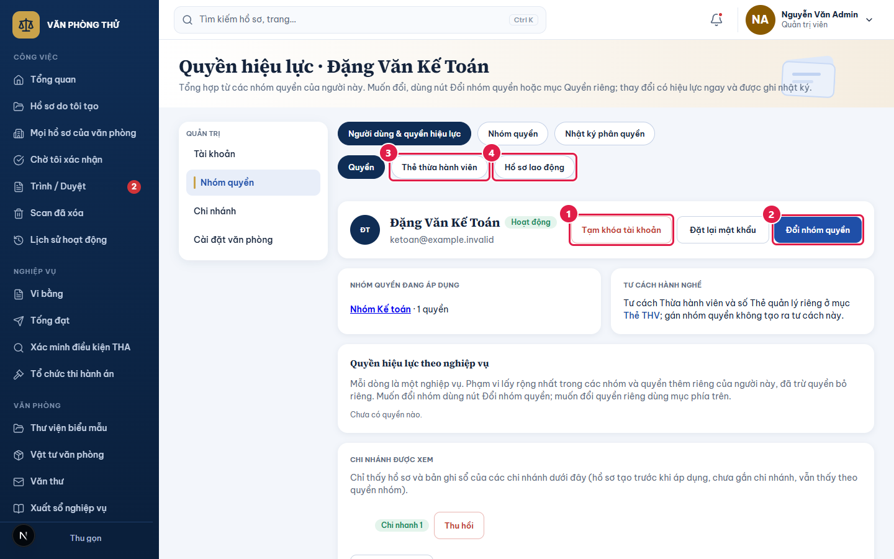

1. Tạm khóa tài khoản
2. Đổi nhóm quyền của người này (áp dụng ngay)
3. Thẻ thừa hành viên của người này
4. Hồ sơ lao động của người này

#### Bước 17.4 · Đổi nhóm hoặc quyền

Chọn loại thay đổi (gán nhóm, gỡ khỏi nhóm, thêm quyền vào nhóm, thu hồi quyền khỏi nhóm), chọn nhóm, chọn thành viên, xem trước rồi ghi lý do và áp dụng. Không còn bước chờ người thứ hai duyệt.

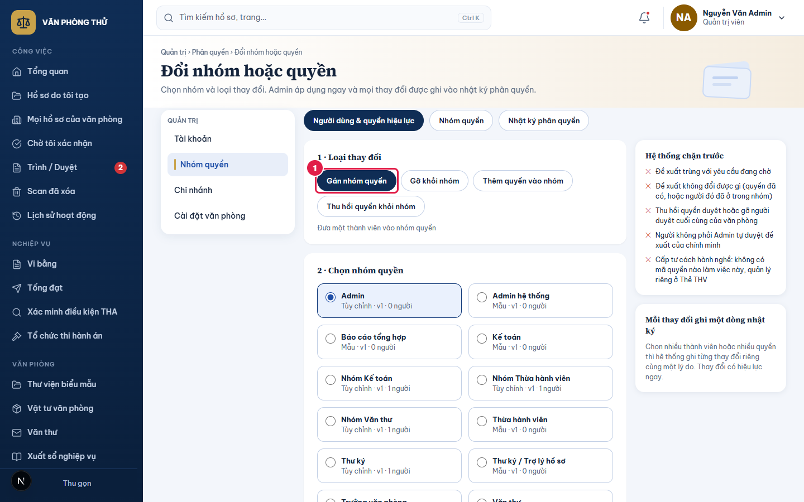

1. Loại thay đổi

#### Bước 17.5 · Quyền riêng của người này

Bảng 7 nghiệp vụ x 6 hành động (phạm vi: của tôi tạo hoặc toàn văn phòng) cộng 8 quyền đặc biệt. Tích để thêm riêng, bỏ tích để bỏ riêng một quyền mà không đổi nhóm.

- Lưu quyền riêng: ghi lại quyền thêm hoặc bỏ riêng, kèm lý do, ghi vào nhật ký.
- Quay về đúng theo nhóm: xóa mọi quyền riêng.

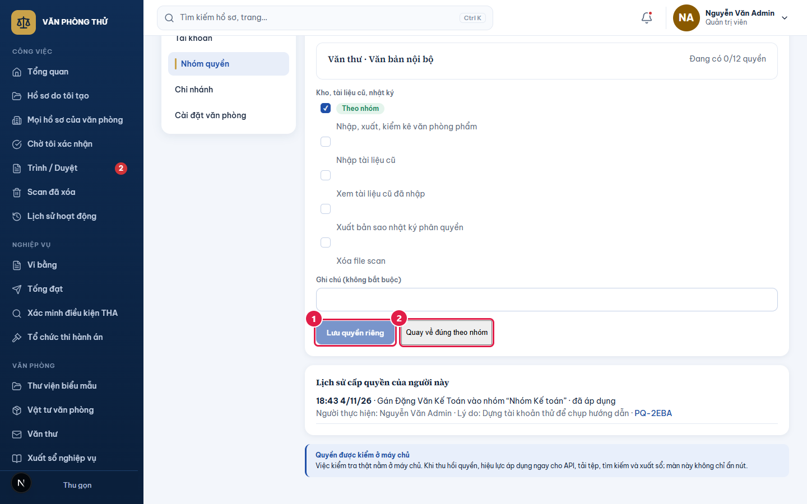

1. Lưu quyền riêng của người này
2. Bỏ hết quyền riêng, quay về đúng theo nhóm

#### Bước 17.6 · Nhật ký phân quyền trong Lịch sử hoạt động

Mọi lần đổi nhóm, quyền, quyền riêng, chi nhánh được ghi tại Lịch sử hoạt động, thẻ Phân quyền. Ai có quyền xuất nhật ký thấy nút "Xuất bản sao".

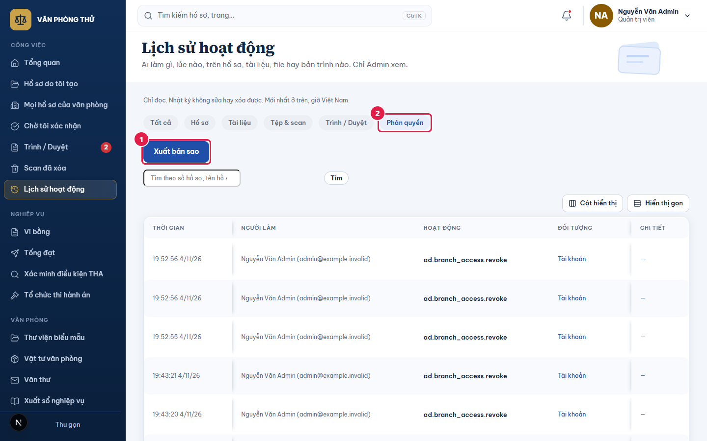

1. Xuất bản sao nhật ký phân quyền
2. Thẻ lọc nhóm hoạt động Phân quyền

### 18. Quản trị · Thẻ thừa hành viên

Mỗi thừa hành viên có số thẻ riêng; số thẻ được ghi vào các sổ và biểu mẫu ở cột Thừa hành viên.

**Cần nhớ:**

- Thiếu thẻ hoặc thẻ ngừng hiệu lực thì không ghi tên thừa hành viên đó được vào sổ.

#### Bước 18.1 · Thẻ THV: danh sách và tình trạng

Thẻ chia theo tình trạng: Còn hiệu lực, Chờ bổ sung, Ngừng hiệu lực. Bấm "Nhập thẻ" để nhập số thẻ cho từng người.

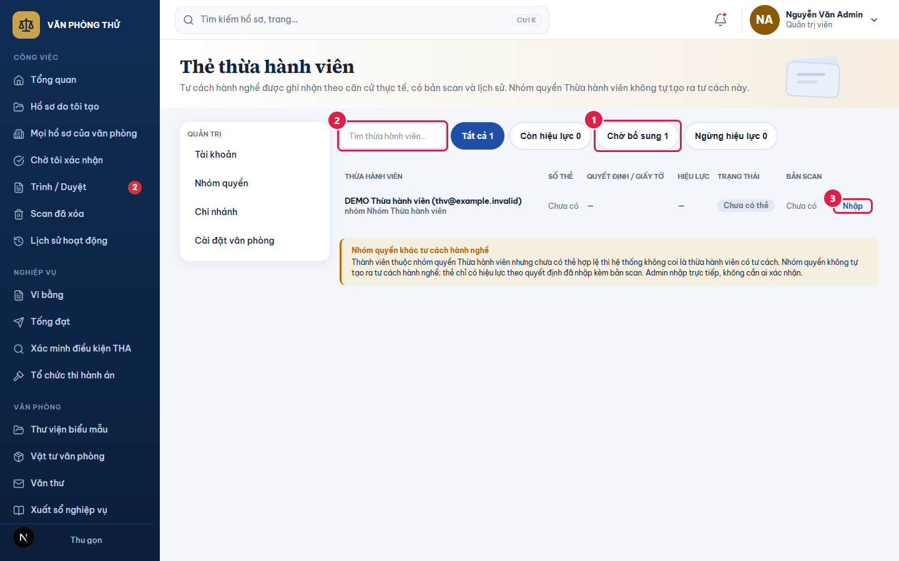

1. Lọc thẻ còn thiếu thông tin
2. Tìm thừa hành viên
3. Nhập thông tin thẻ cho người này

#### Bước 18.2 · Nhập thông tin thẻ

Thẻ chỉ có hiệu lực khi có quyết định hoặc giấy tờ kèm bản scan. Lưu xong thẻ có hiệu lực ngay, không cần ai xác nhận; ngừng hiệu lực không xóa thẻ hay lịch sử.

- Họ tên trên sổ: tên in ở cột Thừa hành viên của các sổ.
- Số thẻ: số thẻ thừa hành viên.
- Số quyết định / giấy tờ và Ngày ban hành quyết định: căn cứ cấp thẻ.
- Ngày hiệu lực: ngày thẻ bắt đầu có hiệu lực.
- Bản scan quyết định (bắt buộc): PDF, JPEG hoặc PNG, tối đa 25 MB.

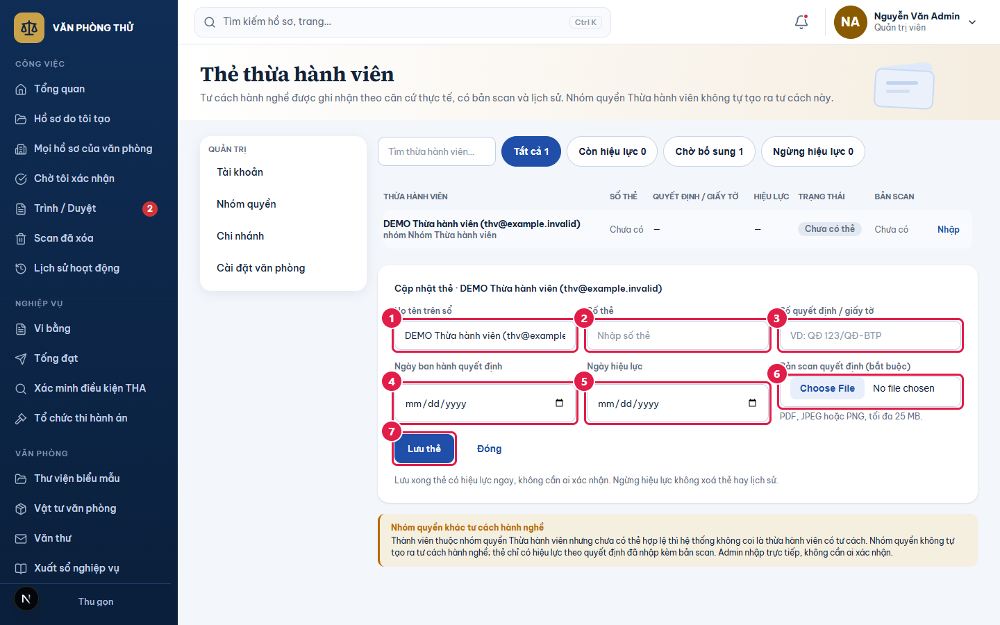

1. Họ tên in trên sổ
2. Số thẻ thừa hành viên
3. Số quyết định hoặc giấy tờ làm căn cứ
4. Ngày ban hành quyết định
5. Ngày thẻ bắt đầu có hiệu lực
6. Bản scan quyết định (bắt buộc)
7. Lưu thẻ

### 19. Quản trị · Email gửi thư (SMTP)

Cấu hình hộp thư hệ thống dùng để gửi liên kết đặt lại mật khẩu và nhắc hạn cho nhân viên.

**Cần nhớ:**

- Mật khẩu SMTP được mã hóa khi lưu và không bao giờ hiện lại trên màn hình.
- Sau khi lưu nên bấm "Gửi thư thử" để chắc thư gửi được.

#### Bước 19.1 · Máy chủ gửi thư (SMTP)

Điền thông tin do nhà cung cấp email cung cấp. Có thể gửi thư thử tới chính bạn để kiểm tra.

- Máy chủ và Cổng: ví dụ smtp.gmail.com, cổng 465.
- Kết nối mã hóa TLS/SSL: tích khi dùng cổng 465.
- Tài khoản và Mật khẩu SMTP: tài khoản gửi thư.
- Địa chỉ người gửi: địa chỉ hiện ở thư gửi đi.

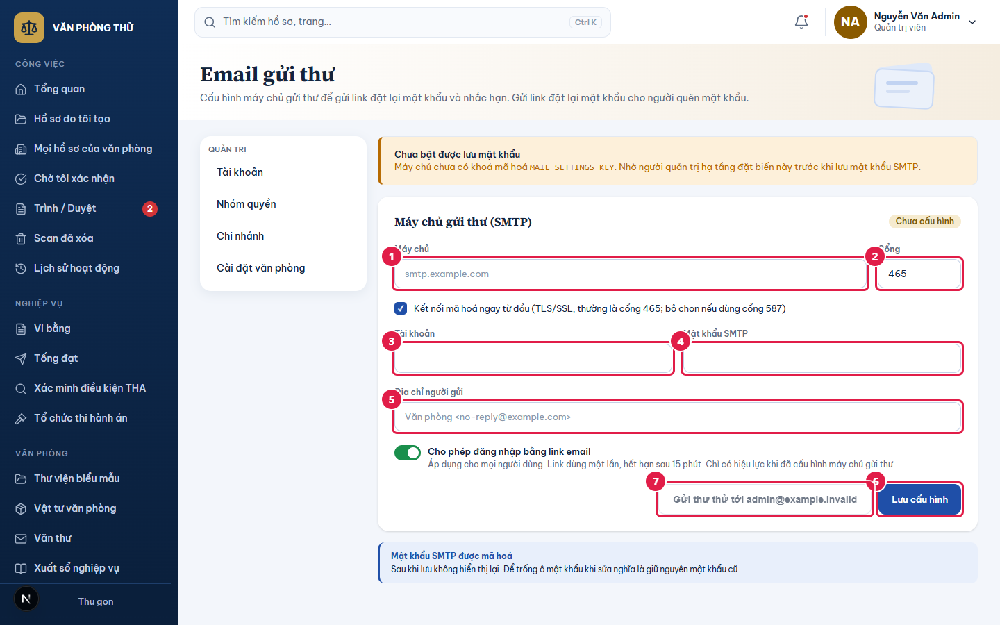

1. Máy chủ gửi thư
2. Cổng
3. Tài khoản SMTP
4. Mật khẩu SMTP (không hiển thị lại)
5. Địa chỉ người gửi
6. Lưu cấu hình
7. Gửi thư thử để kiểm tra

**Lỗi thường gặp và cách xử lý**

| Hiện tượng | Cách xử lý |
| --- | --- |
| Thư thử không đến | Kiểm tra máy chủ, cổng, TLS/SSL đúng nhà cung cấp; với Gmail dùng mật khẩu ứng dụng, không dùng mật khẩu đăng nhập. |

### 20. Quản trị · Lịch làm việc và ngày nghỉ

Lịch quyết định cách tính hạn theo ngày làm việc: ngày làm việc trong tuần và các ngày nghỉ, lễ.

**Cần nhớ:**

- Hạn pháp định và nhắc hạn đều tính theo lịch này. Nhập ngày lễ của năm trước khi dùng.

#### Bước 20.1 · Lịch làm việc

Chọn các thứ trong tuần là ngày làm việc, thêm ngày nghỉ lễ, rồi Lưu lịch. Có công cụ Tính hạn để thử.

- Thứ 2 đến CN: bấm để bật/tắt ngày làm việc.
- + Thêm ngày nghỉ: nhập ngày lễ hoặc nghỉ bù.
- Tính hạn: nhập Từ ngày và Số ngày làm việc để xem ngày hết hạn.

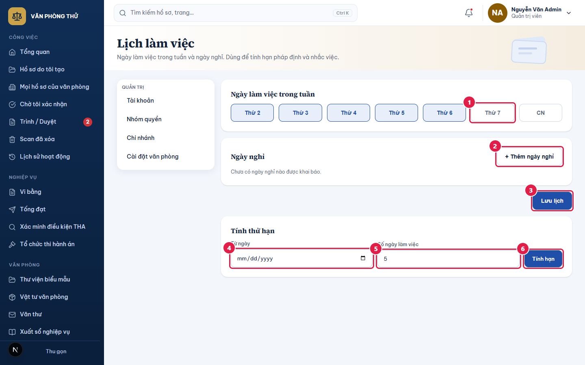

1. Bật/tắt ngày làm việc trong tuần
2. Thêm ngày nghỉ, lễ
3. Lưu lịch
4. Công cụ Tính hạn: từ ngày
5. Số ngày làm việc
6. Tính ngày hết hạn

### 21. Quản trị · Hồ sơ lao động

Hồ sơ lao động của nhân sự văn phòng (dùng cho sổ sử dụng lao động).

**Cần nhớ:**

- Chỉ Admin và Trưởng văn phòng xem được. Không lưu số tiền bảo hiểm, chỉ tình trạng và ghi chú.

#### Bước 21.1 · Hồ sơ lao động

Các thẻ lọc theo tình trạng làm việc. Bấm "+ Thêm hồ sơ" để thêm hồ sơ cho nhân sự.

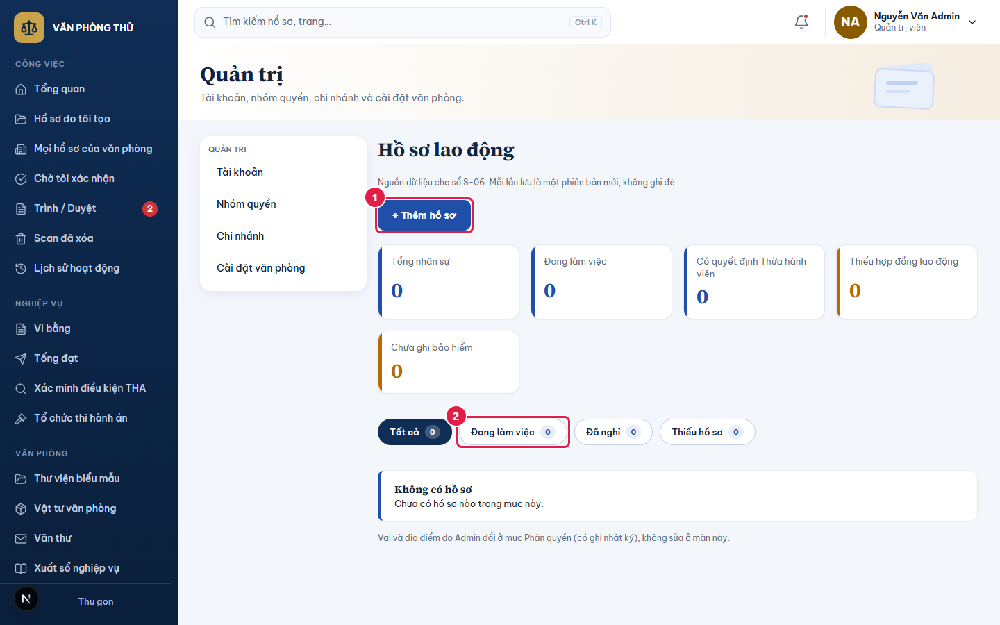

1. Thêm hồ sơ lao động
2. Lọc theo tình trạng

### 22. Quản trị · Cấu hình văn phòng

Thông tin pháp lý của văn phòng in lên biểu mẫu và sổ, cùng quy tắc đánh số hồ sơ.

**Cần nhớ:**

- Đúng tên pháp lý và địa chỉ là bắt buộc vì in lên biểu mẫu chính thức.
- Số cuối của sổ chỉ nhập một lần và chỉ được tăng, để số tiếp theo nối tiếp sổ giấy.

#### Bước 22.1 · Cấu hình văn phòng

Điền đúng thông tin pháp lý, bấm Lưu thay đổi. Phần Quy tắc số cho biết cách đánh số hồ sơ; nút "Nhập số cuối" dùng khi chuyển từ sổ giấy sang phần mềm.

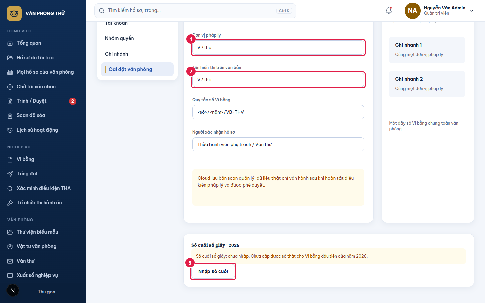

1. Đơn vị pháp lý (tên đầy đủ)
2. Tên hiển thị trên văn bản
3. Nhập số cuối của sổ giấy

### 23. Quản trị · Báo cáo

Báo cáo tổng hợp cho số liệu theo mẫu N-09, N-10.

**Cần nhớ:**

- Mỗi đơn vị tính riêng, không cộng chéo giữa các nghiệp vụ.

#### Bước 23.1 · Báo cáo tổng hợp (N-09, N-10)

Số liệu tổng hợp theo hai mẫu báo cáo. Nút Sao chép ở từng chỉ tiêu giúp chép con số sang văn bản báo cáo.

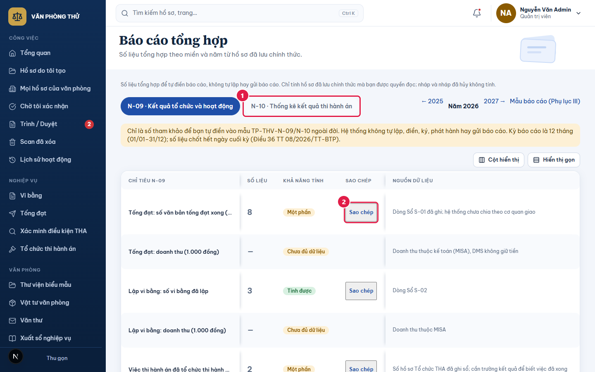

1. Chuyển giữa mẫu N-09 và N-10
2. Sao chép số liệu

### 24. Quản trị · Vật tư văn phòng

Theo dõi tồn kho văn phòng phẩm: nhập, xuất, kiểm kê và ngưỡng cảnh báo sắp hết.

**Cần nhớ:**

- Xuất vượt tồn bị chặn. Điều chỉnh sau kiểm kê cần Trưởng văn phòng duyệt.

#### Bước 24.1 · Vật tư: tồn kho

Thẻ Tồn kho cho thấy số lượng hiện có của từng mặt hàng. "Đặt ngưỡng" để hệ thống báo Sắp hết khi dưới mức đặt.

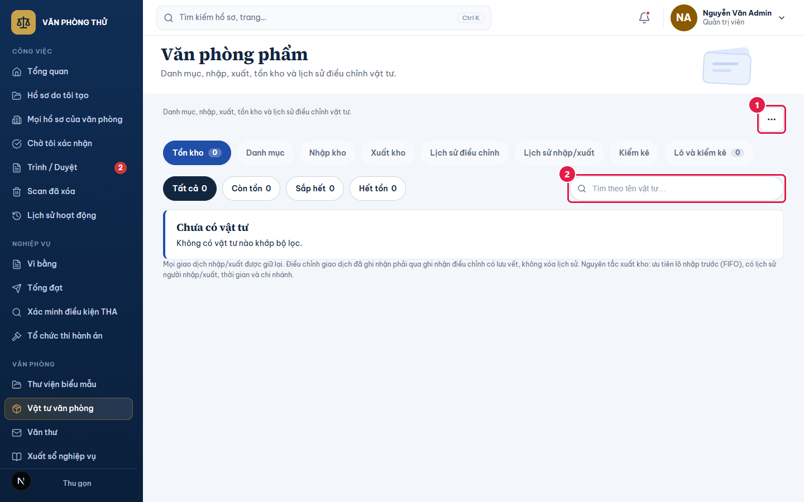

1. Thêm tác vụ vật tư
2. Tìm theo tên vật tư

## Dành cho Trưởng văn phòng

### 25. Trưởng văn phòng: những màn bạn dùng

Trưởng văn phòng theo dõi nghiệp vụ và xem báo cáo trong phạm vi quyền của nhóm quyền được cấp. Việc phân quyền do Admin làm trực tiếp, không còn bước đề xuất và duyệt.

**Cần nhớ:**

- "Duyệt" trong phần mềm là xác nhận nội bộ, không phải chữ ký pháp lý. Văn bản pháp lý vẫn do người có thẩm quyền ký và đóng dấu ngoài đời.
- Quyền của bạn nằm ở nhóm quyền Admin xếp bạn vào; muốn thêm hoặc bớt quyền, nhờ Admin (mọi thay đổi có ghi nhật ký).

#### Bước 25.1 · Tổng quan của Trưởng văn phòng

Thanh bên hiện các mục theo nhóm quyền của bạn, ví dụ Báo cáo tổng hợp. Các thẻ số liệu cho biết tình hình toàn văn phòng trong năm.

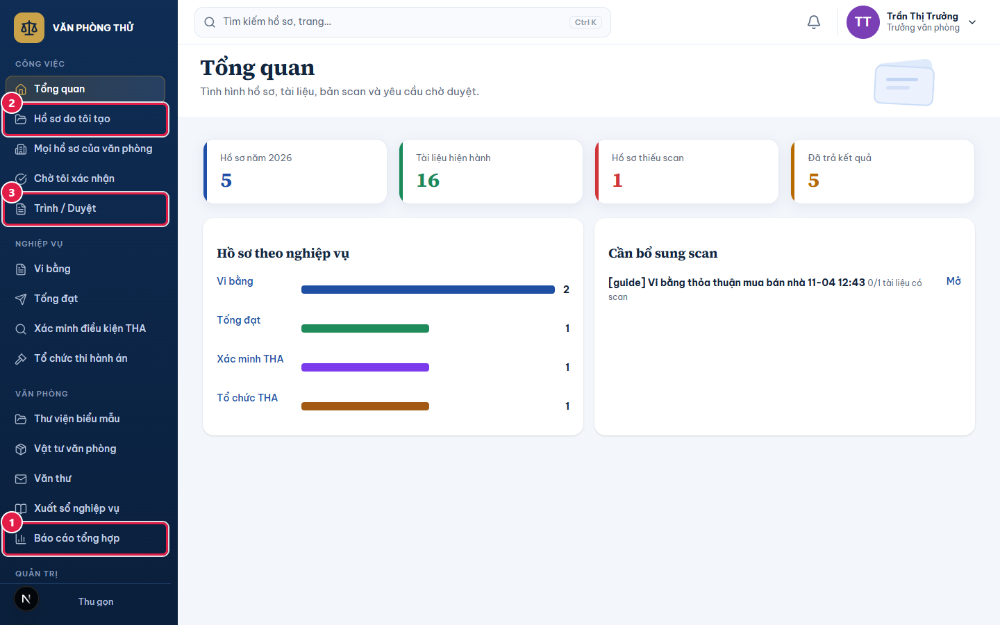

1. Báo cáo tổng hợp N-09, N-10
2. Hồ sơ do tôi tạo
3. Trình / Duyệt

#### Bước 25.2 · Báo cáo tổng hợp N-09, N-10

Chuyển giữa hai mẫu bằng thẻ phía trên. Nút Sao chép ở từng chỉ tiêu giúp chép con số sang văn bản báo cáo.

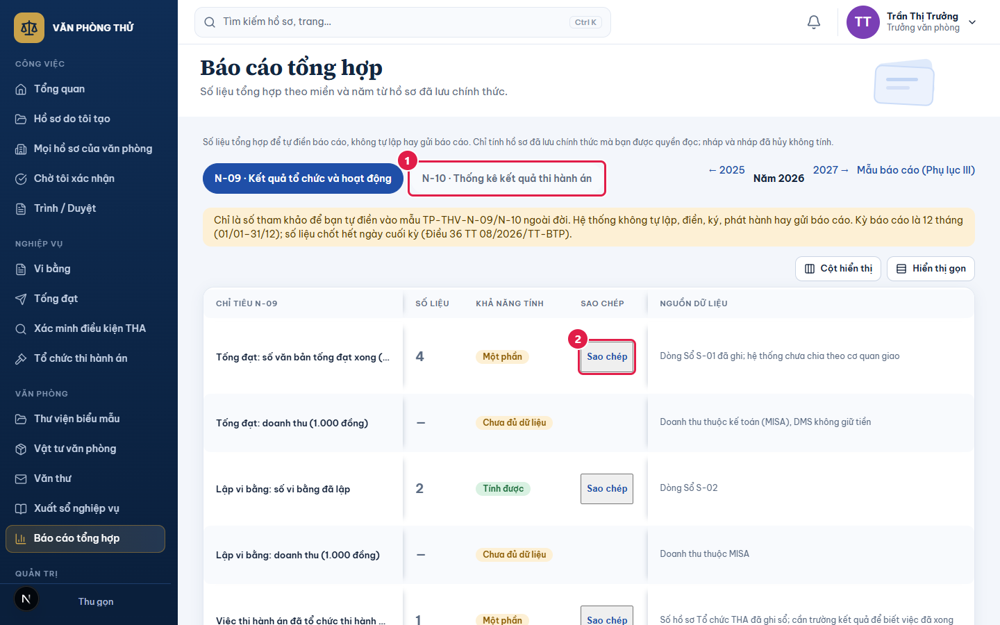

1. Chuyển sang mẫu N-10
2. Sao chép số liệu

**Lỗi thường gặp và cách xử lý**

| Hiện tượng | Cách xử lý |
| --- | --- |
| Danh sách hồ sơ trống | Hồ sơ hiện theo chi nhánh bạn được cấp. Nhờ Admin kiểm tra phạm vi chi nhánh của tài khoản. |
| Không thấy nút tạo hồ sơ | Đúng thiết kế: Trưởng văn phòng theo dõi và duyệt, việc tạo hồ sơ do Thừa hành viên, Thư ký làm. |

## Dành cho Thừa hành viên

### 26. Vi bằng: tạo hồ sơ nháp

Hồ sơ Vi bằng mới luôn bắt đầu là bản NHÁP: chưa có số hồ sơ, chưa vào sổ S-02 và chưa tính vào thống kê. Bạn có thể sửa, thêm tài liệu hoặc hủy nháp thoải mái cho đến khi lưu chính thức.

**Cần nhớ:**

- Bản nháp chưa có số hồ sơ. Số hồ sơ (dạng 034/2026/VB-TPL) chỉ được cấp khi lưu chính thức.
- Tên hồ sơ là ô bắt buộc duy nhất. SĐT khách hàng nên nhập để liên hệ nhưng không in ra sổ.
- Các ô Cột 2 đến Cột 7 chính là các cột của Sổ S-02. Điền đúng chính tả vì đây là nội dung sẽ ghi vào sổ.

#### Bước 26.1 · Bấm "+ Tạo hồ sơ"

Nút nằm ở góc trên bên phải danh sách Vi bằng. Chỉ vai được cấp quyền tạo hồ sơ mới thấy nút này.

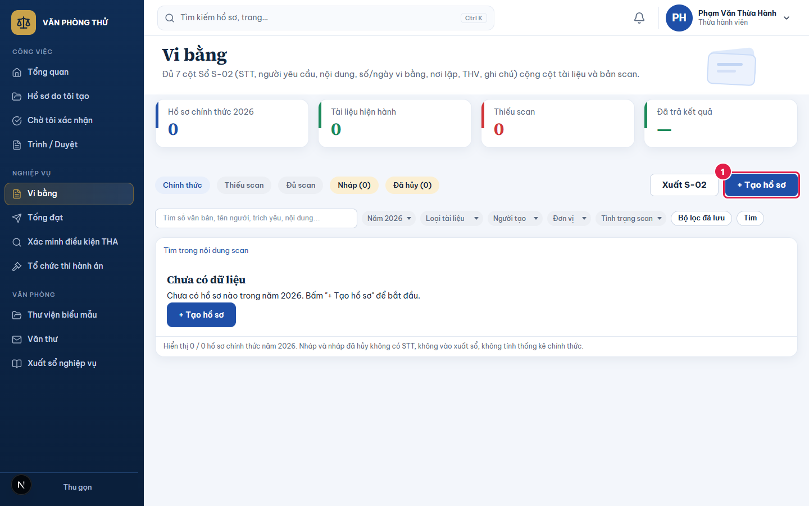

1. Bấm "+ Tạo hồ sơ" để mở biểu mẫu tạo mới

#### Bước 26.2 · Điền thông tin Vi bằng (phần đầu)

Biểu mẫu chia 3 phần: A là thông tin phục vụ Sổ S-02, B là tài liệu đính kèm, C là thông tin hệ thống tự điền.

- Tên hồ sơ (bắt buộc): tên gọi để tìm lại hồ sơ, ví dụ "Vi bằng ghi nhận thỏa thuận mua bán nhà của ông Nguyễn Văn An".
- SĐT khách hàng: số điện thoại liên hệ của người yêu cầu. Chỉ dùng để liên hệ, không in ra sổ.
- Cột 2 (Người yêu cầu lập vi bằng): ghi rõ họ tên và địa chỉ.
- Cột 3 (Nội dung yêu cầu lập vi bằng): mô tả ngắn việc cần ghi nhận.

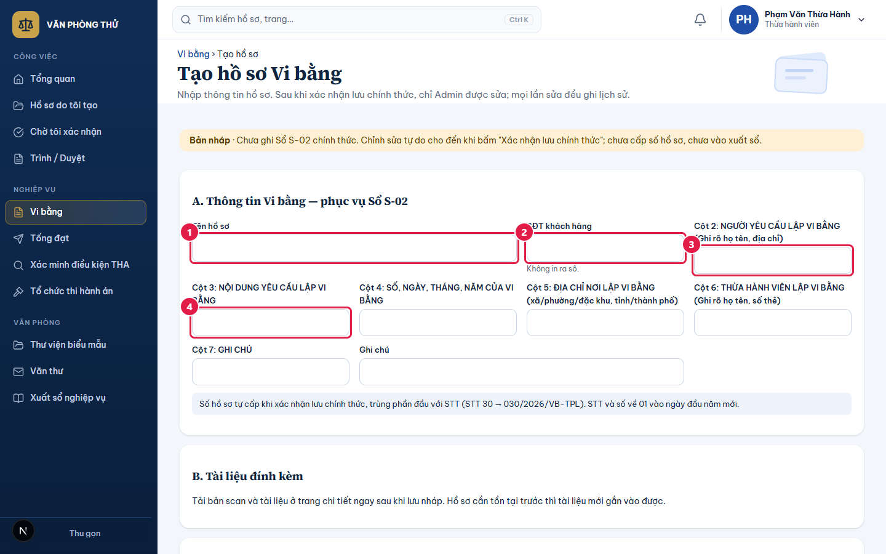

1. Tên hồ sơ (bắt buộc)
2. SĐT khách hàng (10 số, bắt đầu bằng 0)
3. Cột 2: người yêu cầu lập vi bằng (họ tên, địa chỉ)
4. Cột 3: nội dung yêu cầu lập vi bằng

#### Bước 26.3 · Nhập sai SĐT: hệ thống chặn và báo lỗi

SĐT "123" không phải số điện thoại hợp lệ nên hồ sơ chưa được lưu. Sửa lại cho đúng rồi bấm Lưu nháp lần nữa.

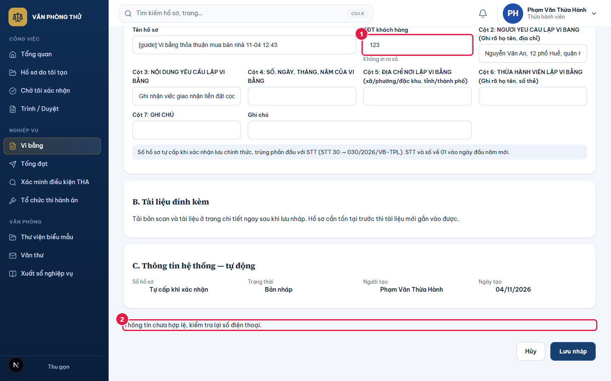

1. Ô SĐT báo lỗi: nhập lại 10 số, bắt đầu bằng 0
2. Thông báo lỗi hiện phía dưới biểu mẫu

#### Bước 26.4 · Điền thông tin Vi bằng (phần cuối) rồi Lưu nháp

Điền tiếp các cột còn lại của Sổ S-02 rồi bấm Lưu nháp. Có thể để trống ô chưa biết và bổ sung sau khi còn là nháp.

- Cột 4 (Số, ngày, tháng, năm của vi bằng): có thể để trống khi còn là nháp.
- Cột 5 (Địa chỉ nơi lập vi bằng): ghi theo xã/phường/đặc khu, tỉnh/thành phố.
- Cột 6 (Thừa hành viên lập vi bằng): ghi rõ họ tên và số thẻ.
- Cột 7 (Ghi chú): thông tin thêm nếu có.

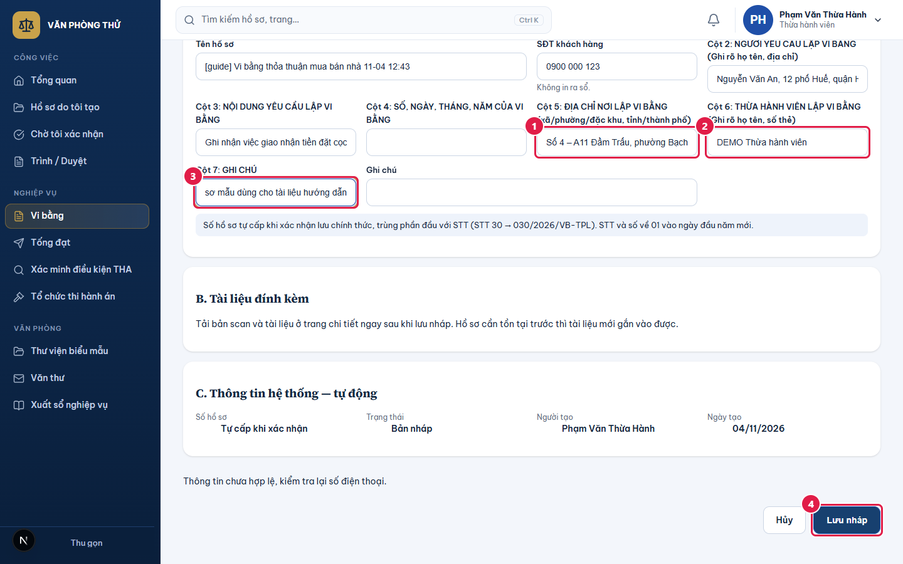

1. Cột 5: địa chỉ nơi lập vi bằng
2. Cột 6: thừa hành viên lập vi bằng (họ tên, số thẻ)
3. Cột 7: ghi chú
4. Bấm Lưu nháp

#### Bước 26.5 · Bản nháp vừa tạo

Hệ thống chuyển sang trang chi tiết của bản nháp. Từ đây bạn lưu thêm, thêm tài liệu, hủy nháp hoặc lưu chính thức.

- Lưu hoặc Lưu nháp: lưu lại các ô vừa sửa, vẫn là bản nháp.
- + Thêm tài liệu: mở tab Tài liệu để thêm văn bản và tải bản scan.
- Hủy nháp: bỏ bản nháp (phải nêu lý do), xem phần "Hủy bản nháp".
- Xác nhận lưu chính thức: cấp số hồ sơ, vào sổ, từ đó không sửa trực tiếp được nữa.

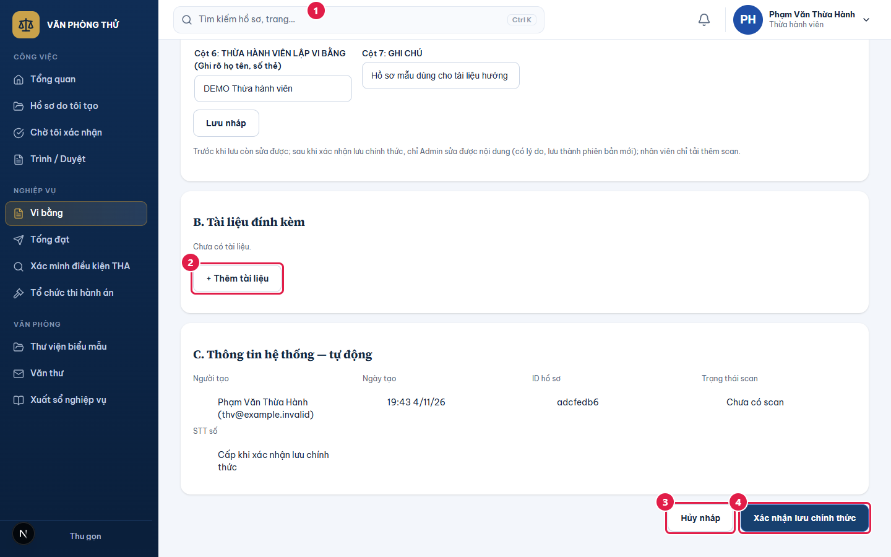

1. Lưu thay đổi (vẫn là bản nháp)
2. Thêm tài liệu cho hồ sơ
3. Hủy bản nháp (cần nêu lý do)
4. Lưu chính thức: cấp số và vào sổ

**Lỗi thường gặp và cách xử lý**

| Hiện tượng | Cách xử lý |
| --- | --- |
| Bấm Lưu nháp báo SĐT không hợp lệ | SĐT phải là số điện thoại Việt Nam (10 số, bắt đầu bằng 0, có thể có dấu cách). Nhập lại cho đúng rồi lưu. |
| Bấm Lưu nháp báo thiếu tên hồ sơ | Điền ô Tên hồ sơ (ví dụ: Vi bằng ghi nhận thỏa thuận mua bán nhà của ông Nguyễn Văn An). |
| Không thấy bản nháp vừa tạo ở tab Chính thức | Bản nháp nằm ở tab Nháp. Chỉ hồ sơ đã lưu chính thức mới hiện ở tab Chính thức. |

### 27. Vi bằng: tài liệu và bản scan

Mỗi hồ sơ gồm một hoặc nhiều tài liệu (biên bản, vi bằng, giấy tờ kèm theo); mỗi tài liệu có các tệp đính kèm, thường là bản scan đã ký và đóng dấu.

**Cần nhớ:**

- Bản scan phải là tệp PDF hoặc ảnh. Nên scan rõ nét, đủ trang, đúng chiều.
- Tệp tải lên được nhận dạng chữ (OCR) tự động sau 1 đến 2 phút để phục vụ tìm theo nội dung.
- Sau khi lưu chính thức, không xóa hay sửa tài liệu đã có; chỉ được tải THÊM scan.

#### Bước 27.1 · Tab Tài liệu: thêm một tài liệu

Tài liệu là một văn bản thuộc hồ sơ. Điền Loại tài liệu và Tên tài liệu rồi bấm "+ Thêm tài liệu".

- Loại tài liệu: mã hoặc loại văn bản, ví dụ N-04.
- Tên tài liệu: tên gọi dễ nhận biết, ví dụ "Vi bằng ghi nhận thỏa thuận mua bán nhà".
- Văn bản chính thức: tích nếu đây là văn bản chính thức của hồ sơ (thường là bản vi bằng đã ký).

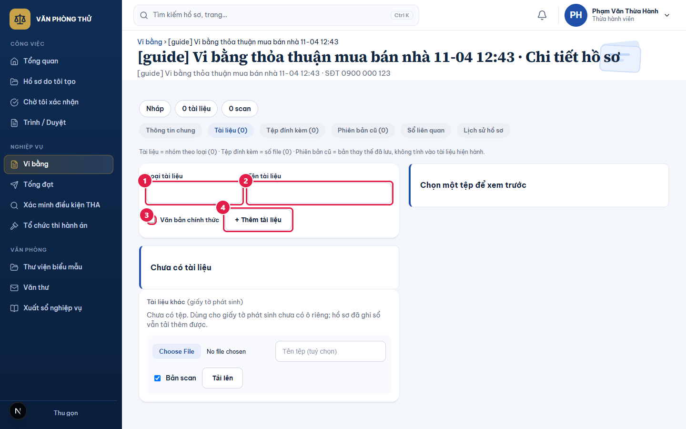

1. Loại tài liệu (ví dụ N-04)
2. Tên tài liệu
3. Tích nếu là văn bản chính thức
4. Bấm để thêm tài liệu

#### Bước 27.2 · Chọn tệp scan và tải lên

Sau khi thêm tài liệu, mục tải tệp hiện ra. Chọn tệp, đặt tên tệp (không bắt buộc), giữ ô "Bản scan" được tích rồi bấm Tải lên.

- Chọn tệp: chọn tệp PDF hoặc ảnh trên máy.
- Tên tệp (tùy chọn): đặt tên dễ nhớ, ví dụ "Bản scan vi bằng đã ký".
- Bản scan: tích nếu đây là bản scan văn bản giấy đã ký, đóng dấu.

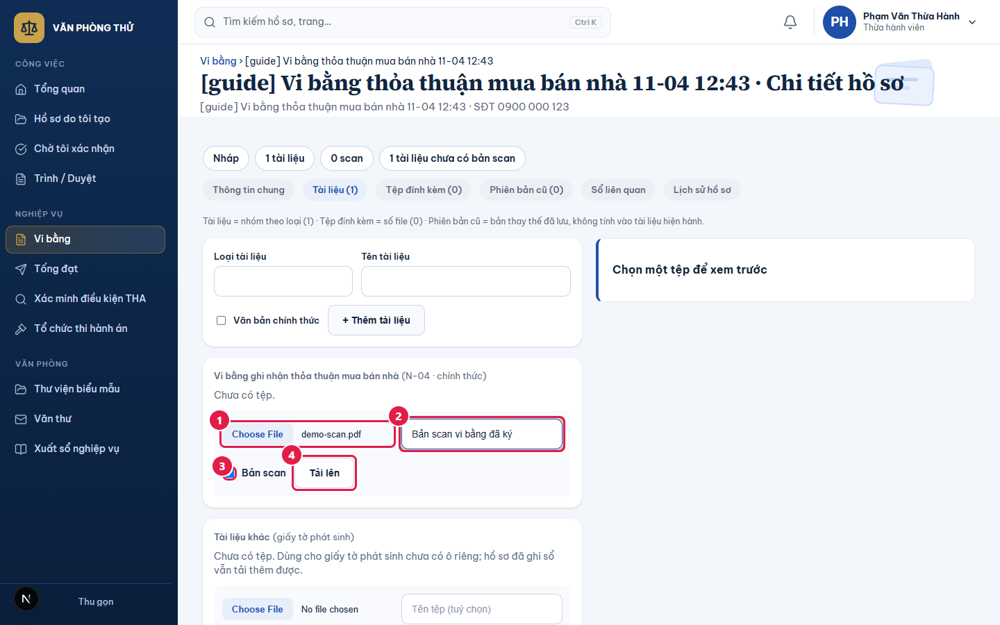

1. Chọn tệp scan trên máy
2. Tên tệp (không bắt buộc)
3. Tích nếu là bản scan
4. Bấm Tải lên

#### Bước 27.3 · Tệp đã tải lên

Tệp hiện trong danh sách tài liệu. Bấm Xem để xem trước ngay bên cạnh. Chữ trong tệp sẽ được nhận dạng sau 1 đến 2 phút để tìm theo nội dung.

1. Bấm Xem để xem trước tệp

**Lỗi thường gặp và cách xử lý**

| Hiện tượng | Cách xử lý |
| --- | --- |
| Bấm Tải lên mà không có gì xảy ra | Chưa chọn tệp. Bấm "Chọn tệp" và chọn tệp PDF hoặc ảnh trước khi bấm Tải lên. |
| Xem trước báo "Chọn một tệp để xem trước" | Hồ sơ chưa có tệp nào. Tải bản scan lên, rồi bấm Xem ở dòng tệp. |

### 28. Vi bằng: hủy bản nháp

Khi mở nhầm hoặc không còn cần bản nháp, bạn hủy nháp. Bản nháp chưa có số và chưa vào sổ nên hủy không làm lệch số.

**Cần nhớ:**

- Chỉ hủy được BẢN NHÁP. Hồ sơ đã lưu chính thức không hủy hay xóa.
- Lý do hủy bắt buộc. Bản nháp hủy chuyển sang tab Đã hủy, vẫn tra cứu được.

#### Bước 28.1 · Hộp thoại Hủy bản nháp

Nhập lý do rồi bấm Xác nhận hủy. Muốn giữ lại bản nháp thì bấm Giữ bản nháp.

1. Lý do hủy nháp (bắt buộc)
2. Giữ bản nháp: đóng hộp thoại, không hủy
3. Xác nhận hủy: bản nháp chuyển sang Đã hủy

**Lỗi thường gặp và cách xử lý**

| Hiện tượng | Cách xử lý |
| --- | --- |
| Nút Xác nhận hủy bị mờ | Chưa nhập Lý do hủy nháp. Nhập lý do rồi bấm lại. |
| Bấm nhầm Hủy nháp | Bấm "Giữ bản nháp" để đóng hộp thoại, không có gì thay đổi. |

### 29. Vi bằng: lưu chính thức (ghi sổ)

Khi nội dung đã đúng, bạn "Xác nhận lưu chính thức". Hệ thống cấp số hồ sơ, đưa hồ sơ vào sổ S-02 và khóa nội dung.

**Cần nhớ:**

- Sau khi lưu chính thức, hồ sơ và tài liệu KHÔNG sửa trực tiếp, KHÔNG xóa. Chỉ Admin sửa được nội dung (có lý do, lưu thành phiên bản mới); nhân viên chỉ tải thêm scan.
- Kiểm tra kỹ từng cột trước khi xác nhận vì đây là nội dung sổ.

#### Bước 29.1 · Hộp thoại xác nhận lưu chính thức

Đọc kỹ lưu ý: sau bước này hồ sơ không sửa trực tiếp được. Bấm Lưu chính thức để cấp số, hoặc Quay lại để kiểm tra thêm.

1. Quay lại để kiểm tra thêm
2. Lưu chính thức: cấp số hồ sơ và vào sổ

#### Bước 29.2 · Hồ sơ sau khi lưu chính thức

Tiêu đề hiện số hồ sơ vừa cấp. Dải thông báo nhắc rằng chỉ Admin sửa được nội dung. Thông tin chung và Nội dung sổ S-02 hiển thị dạng chỉ đọc.

- Các tab: Thông tin chung, Tài liệu, Tệp đính kèm, Phiên bản cũ (các bản trước khi Admin sửa), Sổ liên quan.
- Bạn không thấy nút sửa vì chỉ Admin sửa được hồ sơ đã ghi sổ.

1. Tab Tài liệu: xem và tải thêm scan
2. Tab Phiên bản cũ: các bản trước khi Admin sửa
3. Tab Sổ liên quan

#### Bước 29.3 · Tab Tài liệu của hồ sơ đã ghi sổ

Xem bản scan ngay trong trang. Các nút phía trên khung xem cho phép tải bản scan chính, in, hoặc tải thêm scan.

1. Khung xem trước bản scan
2. Tải bản scan chính về máy
3. In bản scan
4. Tải thêm một tệp scan nữa (cuộn xuống mục tải tệp)

**Lỗi thường gặp và cách xử lý**

| Hiện tượng | Cách xử lý |
| --- | --- |
| Cần sửa hồ sơ đã lưu chính thức | Nhờ Admin sửa (nêu rõ chỗ cần sửa và lý do). Bạn không sửa trực tiếp được. |
| Muốn thêm bản scan sau khi lưu chính thức | Vẫn làm được: mở tab Tài liệu, dùng mục Tải thêm scan. |

### 30. Vi bằng: đánh dấu Đã trả kết quả

Khi đã trả kết quả (vi bằng) cho khách, bạn tích ô "Đã trả kết quả" trên dòng hồ sơ. Ô này chỉ để theo dõi, không đổi trạng thái hồ sơ.

**Cần nhớ:**

- Chỉ tích được với hồ sơ đã lưu chính thức (đã có số). Bản nháp chưa tích được.
- Số hồ sơ đã tích hiện ở thẻ "Đã trả kết quả" trên danh sách và trên Tổng quan.

#### Bước 30.1 · Tìm dòng hồ sơ và tích Đã trả kết quả

Tích vào ô trên dòng hồ sơ. Hệ thống lưu ngay và thẻ "Đã trả kết quả" phía trên tăng thêm 1.

1. Tích khi đã trả kết quả cho khách

#### Bước 30.2 · Đã tích: thẻ Đã trả kết quả tăng

Ô đã được tích và được lưu ngay. Thẻ "Đã trả kết quả" phía trên đếm lại số hồ sơ đã tích (cập nhật khi tải lại trang). Bỏ tích nếu tích nhầm.

1. Ô đã tích
2. Thẻ đếm số hồ sơ đã trả kết quả

**Lỗi thường gặp và cách xử lý**

| Hiện tượng | Cách xử lý |
| --- | --- |
| Không tích được ô Đã trả kết quả | Hồ sơ còn là bản nháp, hoặc bạn không có quyền ghi trên hồ sơ này. |

### 31. Trình / Duyệt: gửi bản trình

Khi cần Admin xem xét một việc kèm bản scan (ví dụ đề nghị cấp bản sao, bổ sung giấy ủy quyền), bạn gửi một bản trình.

**Cần nhớ:**

- Bản trình không phải hồ sơ nghiệp vụ và không tạo số hồ sơ.
- Bạn chỉ thấy bản trình của mình. Admin duyệt hoặc từ chối; nếu từ chối sẽ có ghi chú lý do.

#### Bước 31.1 · Trình / Duyệt: danh sách bản trình của tôi

Bạn chỉ thấy bản trình do mình gửi. Bấm "+ Trình mới" để gửi bản trình mới.

1. Bấm "+ Trình mới" để gửi bản trình
2. Lọc theo trạng thái: Chờ duyệt, Đã duyệt, Từ chối

#### Bước 31.2 · Hộp thoại Trình mới

Điền tiêu đề, mô tả và chọn bản scan (PDF, JPEG hoặc PNG) rồi bấm Gửi bản trình. Không cần chọn loại hay từ khóa.

- Tiêu đề: tóm tắt đề nghị trong một dòng.
- Mô tả: nêu rõ việc cần Admin xem xét.
- Bản scan: có thể chọn nhiều tệp.

1. Tiêu đề bản trình
2. Mô tả đề nghị
3. Chọn bản scan đính kèm
4. Gửi bản trình lên Admin

#### Bước 31.3 · Bản trình vừa gửi ở trạng thái Chờ duyệt

Bản trình hiện trong danh sách với trạng thái Chờ duyệt. Khi Admin duyệt hoặc từ chối, trạng thái đổi theo và bạn nhận thông báo.

1. Bản trình vừa gửi: đang chờ duyệt

**Lỗi thường gặp và cách xử lý**

| Hiện tượng | Cách xử lý |
| --- | --- |
| Bấm Gửi bản trình báo thiếu thông tin | Điền Tiêu đề và chọn ít nhất một bản scan (PDF, JPEG hoặc PNG). |
| Bản trình bị từ chối | Mở bản trình xem ghi chú của Admin, chỉnh lại rồi gửi bản trình mới. |

### 32. Tống đạt: tạo hồ sơ

Mỗi hồ sơ Tống đạt ghi việc tống đạt văn bản: văn bản nào, tống đạt cho ai, kết quả ra sao. Sổ S-01 được dựng từ các hồ sơ chính thức. Cách làm giống nghiệp vụ Vi bằng: tạo bản nháp, thêm tài liệu và bản scan, rồi lưu chính thức; chỉ khác các ô của sổ S-01.

**Cần nhớ:**

- Bản nháp chưa có số hồ sơ và chưa vào sổ S-01. Sau khi lưu chính thức không sửa trực tiếp, không xóa (chỉ Admin sửa có lý do).
- Các ô mang tên "Cột n" chính là cột của sổ; điền đúng chính tả vì đây là nội dung sẽ ghi vào sổ.

#### Bước 32.1 · Tống đạt: danh sách và nút tạo hồ sơ

Danh sách dùng giống nghiệp vụ Vi bằng (tab, bộ lọc, tìm, cột). Bấm "+ Tạo hồ sơ" để tạo bản nháp mới.

1. Tạo hồ sơ mới (bản nháp)
2. Xem trước và xuất sổ S-01

#### Bước 32.2 · Tống đạt: các ô của biểu mẫu tạo hồ sơ

Điền các ô rồi bấm Lưu nháp ở cuối biểu mẫu. Có thể để trống ô chưa biết và bổ sung khi còn là bản nháp.

- Tên hồ sơ (bắt buộc)
- SĐT khách hàng Không in ra sổ.
- Ghi chú

1. Tên hồ sơ (bắt buộc)
2. SĐT khách hàng Không in ra sổ.
3. Ghi chú

**Lỗi thường gặp và cách xử lý**

| Hiện tượng | Cách xử lý |
| --- | --- |
| Không thấy nút "+ Tạo hồ sơ" ở Tống đạt | Tài khoản chưa được cấp quyền tạo hồ sơ nghiệp vụ này. Nhờ Admin kiểm tra phân quyền. |
| Bấm Lưu nháp báo thiếu thông tin | Điền ô bắt buộc (có ghi chú bắt buộc), kiểm tra SĐT đúng 10 số bắt đầu bằng 0. |

### 33. Xác minh điều kiện thi hành án: tạo hồ sơ

Mỗi hồ sơ ghi việc xác minh điều kiện thi hành án theo yêu cầu: người yêu cầu, người phải thi hành, nội dung xác minh và kết quả. Sổ S-04 được dựng từ các hồ sơ chính thức. Cách làm giống nghiệp vụ Vi bằng: tạo bản nháp, thêm tài liệu và bản scan, rồi lưu chính thức; chỉ khác các ô của sổ S-04.

**Cần nhớ:**

- Bản nháp chưa có số hồ sơ và chưa vào sổ S-04. Sau khi lưu chính thức không sửa trực tiếp, không xóa (chỉ Admin sửa có lý do).
- Các ô mang tên "Cột n" chính là cột của sổ; điền đúng chính tả vì đây là nội dung sẽ ghi vào sổ.

#### Bước 33.1 · Xác minh điều kiện thi hành án: danh sách và nút tạo hồ sơ

Danh sách dùng giống nghiệp vụ Vi bằng (tab, bộ lọc, tìm, cột). Bấm "+ Tạo hồ sơ" để tạo bản nháp mới.

1. Tạo hồ sơ mới (bản nháp)
2. Xem trước và xuất sổ S-04

#### Bước 33.2 · Xác minh điều kiện thi hành án: các ô của biểu mẫu tạo hồ sơ

Điền các ô rồi bấm Lưu nháp ở cuối biểu mẫu. Có thể để trống ô chưa biết và bổ sung khi còn là bản nháp.

- Tên hồ sơ (bắt buộc)
- SĐT khách hàng Không in ra sổ.
- Cột 2: HỢP ĐỒNG DỊCH VỤ (số, ngày, tháng, năm)
- Cột 3: QUYẾT ĐỊNH VỀ THI HÀNH ÁN (số, ngày, tháng, năm)
- Cột 4: BẢN ÁN, QUYẾT ĐỊNH CỦA TÒA ÁN
- Cột 5: QUYẾT ĐỊNH XÁC MINH (số, ngày)
- Cột 6: NGƯỜI YÊU CẦU THI HÀNH ÁN
- Cột 7: NGƯỜI PHẢI THI HÀNH ÁN
- Cột 8: NỘI DUNG XÁC MINH
- Cột 9: KẾT QUẢ XÁC MINH

1. Tên hồ sơ (bắt buộc)
2. SĐT khách hàng Không in ra sổ.
3. Cột 2: HỢP ĐỒNG DỊCH VỤ (số, ngày, tháng, năm)
4. Cột 3: QUYẾT ĐỊNH VỀ THI HÀNH ÁN (số, ngày, tháng, năm)
5. Cột 4: BẢN ÁN, QUYẾT ĐỊNH CỦA TÒA ÁN
6. Cột 5: QUYẾT ĐỊNH XÁC MINH (số, ngày)
7. Cột 6: NGƯỜI YÊU CẦU THI HÀNH ÁN
8. Cột 7: NGƯỜI PHẢI THI HÀNH ÁN
9. Cột 8: NỘI DUNG XÁC MINH
10. Cột 9: KẾT QUẢ XÁC MINH

**Lỗi thường gặp và cách xử lý**

| Hiện tượng | Cách xử lý |
| --- | --- |
| Không thấy nút "+ Tạo hồ sơ" ở Xác minh điều kiện thi hành án | Tài khoản chưa được cấp quyền tạo hồ sơ nghiệp vụ này. Nhờ Admin kiểm tra phân quyền. |
| Bấm Lưu nháp báo thiếu thông tin | Điền ô bắt buộc (có ghi chú bắt buộc), kiểm tra SĐT đúng 10 số bắt đầu bằng 0. |

### 34. Tổ chức thi hành án: tạo hồ sơ

Mỗi hồ sơ ghi việc tổ chức thi hành một bản án, quyết định: đương sự, nội dung, kết quả. Sổ S-05 được dựng từ các hồ sơ chính thức. Cách làm giống nghiệp vụ Vi bằng: tạo bản nháp, thêm tài liệu và bản scan, rồi lưu chính thức; chỉ khác các ô của sổ S-05.

**Cần nhớ:**

- Bản nháp chưa có số hồ sơ và chưa vào sổ S-05. Sau khi lưu chính thức không sửa trực tiếp, không xóa (chỉ Admin sửa có lý do).
- Các ô mang tên "Cột n" chính là cột của sổ; điền đúng chính tả vì đây là nội dung sẽ ghi vào sổ.

#### Bước 34.1 · Tổ chức thi hành án: danh sách và nút tạo hồ sơ

Danh sách dùng giống nghiệp vụ Vi bằng (tab, bộ lọc, tìm, cột). Bấm "+ Tạo hồ sơ" để tạo bản nháp mới.

1. Tạo hồ sơ mới (bản nháp)
2. Xem trước và xuất sổ S-05

#### Bước 34.2 · Tổ chức thi hành án: các ô của biểu mẫu tạo hồ sơ

Điền các ô rồi bấm Lưu nháp ở cuối biểu mẫu. Có thể để trống ô chưa biết và bổ sung khi còn là bản nháp.

- Tên hồ sơ (bắt buộc)
- SĐT khách hàng Không in ra sổ.
- Cột 2: HỢP ĐỒNG DỊCH VỤ (số, ngày, tháng, năm)
- Cột 3: QUYẾT ĐỊNH VỀ THI HÀNH ÁN · Số, ngày, tháng, năm
- Cột 4: QUYẾT ĐỊNH VỀ THI HÀNH ÁN · Sửa đổi, bổ sung
- Cột 5: QUYẾT ĐỊNH VỀ THI HÀNH ÁN · Thu hồi
- Cột 6: BẢN ÁN, QUYẾT ĐỊNH CỦA TÒA ÁN
- Cột 7: BÊN PHẢI THI HÀNH ÁN (họ tên/tên gọi, địa chỉ)
- Cột 8: BÊN ĐƯỢC THI HÀNH ÁN (họ tên/tên gọi, địa chỉ)
- Cột 9: CÁC KHOẢN PHẢI THI HÀNH ÁN (theo hợp đồng)

1. Tên hồ sơ (bắt buộc)
2. SĐT khách hàng Không in ra sổ.
3. Cột 2: HỢP ĐỒNG DỊCH VỤ (số, ngày, tháng, năm)
4. Cột 3: QUYẾT ĐỊNH VỀ THI HÀNH ÁN · Số, ngày, tháng, năm
5. Cột 4: QUYẾT ĐỊNH VỀ THI HÀNH ÁN · Sửa đổi, bổ sung
6. Cột 5: QUYẾT ĐỊNH VỀ THI HÀNH ÁN · Thu hồi
7. Cột 6: BẢN ÁN, QUYẾT ĐỊNH CỦA TÒA ÁN
8. Cột 7: BÊN PHẢI THI HÀNH ÁN (họ tên/tên gọi, địa chỉ)
9. Cột 8: BÊN ĐƯỢC THI HÀNH ÁN (họ tên/tên gọi, địa chỉ)
10. Cột 9: CÁC KHOẢN PHẢI THI HÀNH ÁN (theo hợp đồng)

**Lỗi thường gặp và cách xử lý**

| Hiện tượng | Cách xử lý |
| --- | --- |
| Không thấy nút "+ Tạo hồ sơ" ở Tổ chức thi hành án | Tài khoản chưa được cấp quyền tạo hồ sơ nghiệp vụ này. Nhờ Admin kiểm tra phân quyền. |
| Bấm Lưu nháp báo thiếu thông tin | Điền ô bắt buộc (có ghi chú bắt buộc), kiểm tra SĐT đúng 10 số bắt đầu bằng 0. |

### 35. Thừa hành viên: Chờ tôi xác nhận

Mục này liệt kê các bản nháp người khác soạn và ghi tên bạn. Bạn xem lại nội dung rồi xác nhận lưu chính thức hoặc báo lại người soạn.

**Cần nhớ:**

- Kiểm tra kỹ từng cột trước khi xác nhận vì sau đó hồ sơ không sửa trực tiếp được.

#### Bước 35.1 · Chờ tôi xác nhận

Mỗi dòng là một bản nháp đang chờ bạn. Bấm "Xem và xác nhận" để mở.

- Hồ sơ nháp, Nghiệp vụ, Ngày tạo, Trạng thái: thông tin nhanh để chọn việc.

1. Mở bản nháp để xem và xác nhận

#### Bước 35.2 · Xem và xác nhận nội dung bản nháp

Hệ thống hiện lại toàn bộ nội dung hồ sơ và các tài liệu. Đọc kỹ; nếu đúng thì bấm "Tôi xác nhận nội dung này". Nếu người nhập liệu sửa lại sau khi bạn xác nhận, bạn phải xác nhận lại.

- Nội dung hồ sơ: các ô người soạn đã điền (hiển thị chỉ đọc).
- Tài liệu: các tài liệu đã đính kèm vào bản nháp.

1. Quay lại danh sách Chờ tôi xác nhận
2. Nội dung hồ sơ cần kiểm tra
3. Xác nhận nội dung (sau đó hồ sơ đủ điều kiện lưu chính thức)

**Lỗi thường gặp và cách xử lý**

| Hiện tượng | Cách xử lý |
| --- | --- |
| Danh sách "Chờ tôi xác nhận" trống | Chưa có bản nháp nào ghi tên bạn. Báo người soạn chọn đúng bạn ở ô "Thừa hành viên được ghi tên". |

## Dành cho Thư ký

### 36. Thư ký: tạo hồ sơ và hỗ trợ nghiệp vụ

Thư ký tạo bản nháp hồ sơ cho bốn nghiệp vụ, thêm tài liệu và tải bản scan, hỗ trợ Thừa hành viên. Cách tạo và lưu chính thức giống phần Vi bằng của Thừa hành viên.

**Cần nhớ:**

- Hồ sơ mới là bản nháp: chưa có số hồ sơ, chưa vào sổ cho tới khi xác nhận lưu chính thức.
- Sau khi lưu chính thức không sửa trực tiếp, không xóa. Chỉ Admin sửa (có lý do); bạn chỉ tải thêm scan.

#### Bước 36.1 · Danh sách hồ sơ của Thư ký

Bạn có nút "+ Tạo hồ sơ" ở các nghiệp vụ được cấp quyền. Cách điền biểu mẫu xem phần Vi bằng trong hướng dẫn Thừa hành viên.

1. Tạo hồ sơ mới (bản nháp)
2. Bản nháp của bạn nằm ở tab Nháp

#### Bước 36.2 · Tổng quan của Thư ký

Thanh bên của Thư ký gồm Chờ tôi xác nhận, Trình / Duyệt, các nghiệp vụ, Văn thư, Xuất sổ và Báo cáo tổng hợp.

1. Hồ sơ nháp đang chờ xác nhận
2. Báo cáo tổng hợp
3. Xuất sổ nghiệp vụ

**Lỗi thường gặp và cách xử lý**

| Hiện tượng | Cách xử lý |
| --- | --- |
| Không thấy nút "+ Tạo hồ sơ" ở một nghiệp vụ | Tài khoản chưa được cấp quyền tạo hồ sơ nghiệp vụ đó. Nhờ Admin kiểm tra phân quyền. |

### 37. Thư ký: soạn bản nháp

Thư ký soạn bản nháp: điền thông tin, thêm tài liệu, tải bản scan. Với vai Thư ký, bản nháp có Lưu, Lưu nháp và Hủy nháp; không có nút "Xác nhận lưu chính thức" và ô "Thừa hành viên được ghi tên" chỉ có lựa chọn "Không ghi tên".

**Cần nhớ:**

- Bản nháp chưa có số hồ sơ, chưa vào sổ. Bạn Hủy nháp được (phải nêu lý do).
- Việc xác nhận lưu chính thức do người có quyền thực hiện; hỏi Trưởng văn phòng hoặc Admin quy trình của văn phòng.

#### Bước 37.1 · Bản nháp do Thư ký soạn

Thư ký có Lưu, Lưu nháp và Hủy nháp; không có "Xác nhận lưu chính thức". Ô thừa hành viên chỉ có "Không ghi tên" vì bạn không có quyền chọn.

1. Thừa hành viên được ghi tên (Admin sẽ chọn)
2. Lưu thay đổi
3. Hủy nháp (cần nêu lý do)

**Lỗi thường gặp và cách xử lý**

| Hiện tượng | Cách xử lý |
| --- | --- |
| Không thấy nút "Xác nhận lưu chính thức" | Đúng thiết kế của vai Thư ký. Báo người phụ trách xác nhận. |
| Ô "Thừa hành viên được ghi tên" chỉ có "Không ghi tên" | Vai Thư ký không có quyền chọn thừa hành viên. |

## Dành cho Văn thư

### 38. Văn thư: sổ Văn bản đến, đi và nội bộ

Văn thư giữ ba sổ: Văn bản đến, Văn bản đi và Văn bản nội bộ. Mỗi văn bản là một hồ sơ có số thứ tự (STT) riêng theo năm, kèm bản scan.

**Cần nhớ:**

- Hồ sơ mới là bản nháp: chưa có STT, chưa vào sổ cho tới khi xác nhận lưu chính thức.
- Sau khi lưu chính thức không sửa trực tiếp, không xóa; chỉ Admin sửa (có lý do) và nhân viên chỉ tải thêm scan.
- Mỗi sổ đánh số riêng và về 01 vào ngày đầu năm mới.

#### Bước 38.1 · Sổ Văn bản đến

Ba nút chuyển giữa sổ Văn bản đến, Văn bản đi, Văn bản nội bộ nằm ngay dưới tiêu đề. Mỗi dòng của bảng là một văn bản đã vào sổ.

- Chính thức: văn bản đã có STT. Nháp: chưa vào sổ. Đã hủy: nháp đã bỏ.
- Xuất PDF để in: bản in sổ năm đang chọn. Xuất Excel: tải dữ liệu sổ dạng bảng tính.
- Ô tìm và các bộ lọc dùng như danh sách hồ sơ nghiệp vụ.

1. Chuyển sang sổ Văn bản đi hoặc Văn bản nội bộ
2. Tab Chính thức, Nháp, Đã hủy
3. Xuất Excel
4. Xuất PDF để in sổ
5. Thêm một văn bản mới vào sổ

#### Bước 38.2 · Tạo bản nháp văn bản mới

Điền tên loại và trích yếu nội dung, ghi chú nếu cần rồi bấm "+ Tạo nháp". Hệ thống mở trang chi tiết của bản nháp.

- Tên loại và trích yếu nội dung (bắt buộc): ghi loại văn bản và nội dung chính, ví dụ "Công văn số 12/UBND về việc phối hợp xác minh".
- Ghi chú: thông tin thêm nếu có.

1. Tên loại và trích yếu nội dung (bắt buộc)
2. Ghi chú (không bắt buộc)
3. Tạo bản nháp

#### Bước 38.3 · Bản nháp văn bản: thêm tài liệu rồi lưu chính thức

Cũng như hồ sơ nghiệp vụ, bản nháp cho phép sửa, thêm tài liệu và tải bản scan. Khi đã đúng, bấm Xác nhận lưu chính thức để cấp STT và vào sổ.

1. Thêm tài liệu và tải bản scan
2. Hủy bản nháp (cần nêu lý do)
3. Lưu chính thức: cấp STT và vào sổ

#### Bước 38.4 · Sổ Văn bản đi và Văn bản nội bộ

Hai sổ này dùng đúng cách như Văn bản đến: chuyển bằng nút phía trên, mỗi sổ có STT riêng.

1. Chuyển sang sổ Văn bản nội bộ

**Lỗi thường gặp và cách xử lý**

| Hiện tượng | Cách xử lý |
| --- | --- |
| Không thấy nút "+ Thêm bản ghi" | Tài khoản của bạn chưa được cấp quyền tạo hồ sơ cho sổ này. Nhờ Admin kiểm tra phân quyền. |
| Văn bản vừa tạo không thấy ở tab Chính thức | Văn bản còn là nháp nên nằm ở tab Nháp. Mở và bấm Xác nhận lưu chính thức để vào sổ. |
| Cần in sổ để lưu giấy | Bấm "Xuất PDF để in" hoặc "Xuất Excel" ở đầu danh sách. |

### 39. Văn thư: gửi bản trình

Văn thư cũng gửi được bản trình (tiêu đề, mô tả, bản scan) để Admin duyệt. Cách làm giống Thừa hành viên.

**Cần nhớ:**

- Bạn chỉ thấy bản trình của mình; Admin duyệt hoặc từ chối kèm ghi chú.

#### Bước 39.1 · Trình / Duyệt của Văn thư

Bấm "+ Trình mới" để gửi bản trình, xem trạng thái ở danh sách bên dưới. Chi tiết từng ô xem phần Trình / Duyệt trong hướng dẫn dành cho Thừa hành viên.

1. Gửi bản trình mới

## Dành cho Kế toán

### 40. Kế toán: Tổng quan và Vật tư văn phòng

Trong phần hồ sơ DMS, Kế toán chỉ có Tổng quan và Vật tư văn phòng. Phần mềm KHÔNG làm kế toán: MISA là sổ kế toán duy nhất, phần mềm không lưu số tiền.

**Cần nhớ:**

- Không nhập số tiền, công nợ hay bút toán vào phần mềm.
- Xuất kho vượt số tồn bị chặn. Điều chỉnh sau kiểm kê cần Trưởng văn phòng duyệt.

#### Bước 40.1 · Tổng quan của Kế toán

Thanh bên chỉ có hai mục: Tổng quan và Vật tư văn phòng.

1. Vật tư văn phòng

#### Bước 40.2 · Vật tư: tồn kho, nhập và xuất

Thẻ Tồn kho cho thấy số lượng hiện có. "Nhập / xuất" để ghi nhập hoặc xuất kho; "Đặt ngưỡng" để hệ thống báo Sắp hết.

1. Tìm theo tên vật tư

**Lỗi thường gặp và cách xử lý**

| Hiện tượng | Cách xử lý |
| --- | --- |
| Không thấy mục hồ sơ nghiệp vụ | Đúng thiết kế: Kế toán không thao tác hồ sơ nghiệp vụ trong DMS. |

